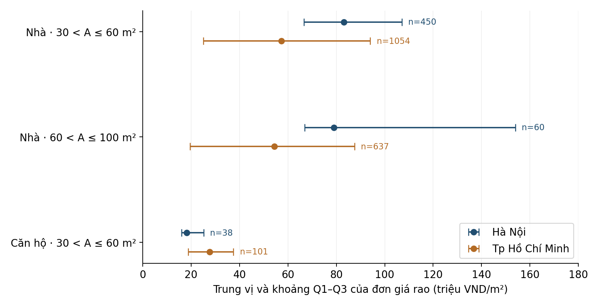
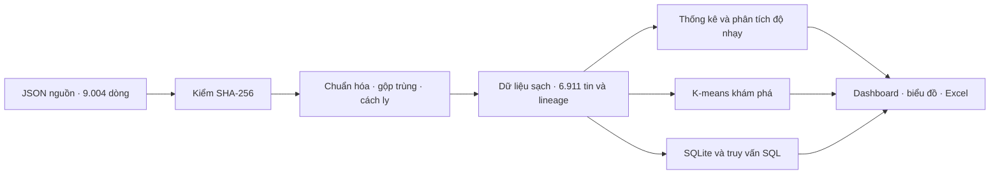

# Phân tích giá rao bất động sản Việt Nam

Đồ án **Nhập môn Khoa học dữ liệu** xây dựng quy trình làm sạch, phân tích và trực quan hóa một mẫu tin rao bất động sản lịch sử tại Việt Nam. Sản phẩm gồm dashboard tương tác, workbook Excel, cơ sở dữ liệu SQLite và báo cáo tiểu luận sáu chương.

**Học viện Công nghệ Bưu chính Viễn thông · Nhóm 7**

Học phần: Nhập môn Khoa học dữ liệu · Giảng viên: ThS. Nguyễn Ngọc Duy

| Thành viên | Mã số sinh viên |
|---|---|
| Võ Văn Đạt | N23DCCN078 |
| Nguyễn Thị Yến Nhi | N23DCCN112 |
| Hứa Như Quỳnh | N23DCCN118 |

## Xem nhanh sản phẩm

| Sản phẩm | Tệp | Cách sử dụng |
|---|---|---|
| Báo cáo đã rà soát | [Word](docs/BAO_CAO_TIEU_LUAN_DA_RA_SOAT.docx) · [PDF](docs/BAO_CAO_TIEU_LUAN_DA_RA_SOAT.pdf) | Đọc nội dung, phương pháp, kết quả và giới hạn của đề tài |
| Dashboard | [Dashboard HTML](outputs/DASHBOARD_BAT_DONG_SAN.html) | Tải repo, chạy `MO_DASHBOARD.cmd` hoặc mở tệp HTML bằng trình duyệt |
| Phân tích Excel | [Workbook Excel](outputs/DO_AN_BAT_DONG_SAN.xlsx) | Tải tệp và mở bằng Microsoft Excel |
| Dữ liệu đã xử lý | [CSV](data/processed/listings_clean.csv) · [JSON](data/processed/listings_clean.json) | Xem 6.911 tin cùng các biến dẫn xuất và cờ chất lượng |
| Cơ sở dữ liệu | [SQLite](outputs/real_estate.sqlite) · [SQL minh họa](sql/02_queries.sql) | Mở bằng công cụ SQLite hoặc chạy `scripts/demo_sql.py` |
| Phân tích mở rộng | [Trang kết quả](outputs/extended/summary.html) · [Phương pháp và giới hạn](docs/KET_QUA_HOAN_THIEN_3_MUC_TIEU.md) | Tải về để xem HTML; đọc phân tích theo nhóm và độ nhạy phân cụm |

GitHub hiển thị mã nguồn của tệp HTML. Để dùng dashboard, chọn **Code → Download ZIP**, giải nén rồi mở tệp trên máy. Dashboard có dữ liệu nhúng sẵn và hoạt động ngoại tuyến.

## Mục tiêu và câu hỏi nghiên cứu

Mục tiêu duy nhất là hỗ trợ khám phá và so sánh đặc điểm **giá rao trong mẫu dữ liệu lịch sử**, thông qua quy trình có thể tái lập và truy nguyên tới bản ghi nguồn.

Đồ án tập trung trả lời bốn câu hỏi:

1. Dữ liệu đầu vào có chất lượng như thế nào và còn lại bao nhiêu tin sau xử lý?
2. Diện tích có liên hệ với tổng giá rao ra sao, trên toàn mẫu và trong từng nhóm?
3. Đơn giá khác nhau thế nào giữa địa phương khi so sánh cùng loại tài sản và khoảng diện tích?
4. Kết quả thay đổi ra sao khi xử lý ngoại lệ hoặc thay đổi cách biểu diễn dữ liệu?

## Kết quả chính

Kết quả bàn giao sử dụng cùng mã lần chạy `20261027T065401Z-5c8df2cc`.

| Chỉ tiêu | Giá trị |
|---|---:|
| Bản ghi nguồn thực tế | 9.004 |
| Dòng trùng được gộp theo khóa nội dung | 1.884 |
| Tin được cách ly | 209 |
| Tin được giữ để phân tích | 6.911 |
| Trung vị tổng giá rao | 2,25 tỷ VND |
| Trung vị diện tích | 70 m² |
| Trung vị đơn giá rao | 32,50 triệu VND/m² |
| Tin dùng để phân cụm sau loại ngoại lệ IQR theo nhóm | 6.652 |

Số dòng được bảo toàn: **9.004 = 1.884 + 209 + 6.911**. Trạng thái của từng dòng nguồn được lưu trong [bảng truy nguyên](data/processed/row_lineage.csv); thống kê đầy đủ nằm ở [analysis.json](outputs/analysis.json).



*Minh họa từ dữ liệu của đồ án: điểm là trung vị, đoạn ngang là khoảng Q1–Q3; mỗi nhóm có từ 38 đến 1.054 tin. [Bảng số liệu của hình](docs/review_20261029/assets/conditional_comparison.csv).*

So sánh có điều kiện cho thấy thứ tự giữa Hà Nội và TP.HCM thay đổi theo loại tài sản: nhóm nhà 30–60 m² có trung vị lần lượt khoảng 83,10 và 57,25 triệu VND/m²; nhóm căn hộ cùng khoảng có trung vị khoảng 18,18 và 27,63 triệu VND/m². Kết quả mô tả mẫu đã thu thập; chưa kiểm soát quận, chất lượng hay vị trí cụ thể.

## Quy trình và chức năng



- **Chuẩn bị dữ liệu:** chuẩn hóa chuỗi và đơn vị, phục hồi diện tích khi đủ bằng chứng, phát hiện mâu thuẫn, gộp trùng và lưu lý do cách ly.
- **Phân tích và trực quan hóa:** phân bố giá, quan hệ diện tích–giá, so sánh theo tỉnh/loại, tương quan Spearman và độ nhạy theo chính sách xử lý.
- **Dashboard:** lọc tỉnh, loại tài sản, phạm vi giao dịch và ngoại lệ; xem KPI, biểu đồ, bảng dữ liệu, phân trang và xuất CSV.
- **Học máy khám phá:** cài đặt K-means bằng NumPy; lựa chọn k bằng các phép đo trong mẫu và kiểm tra độ nhạy với đặc trưng, chuẩn hóa, seed và mẫu con.
- **Cơ sở dữ liệu:** SQLite gồm ba bảng `provinces`, `property_types`, `listings`; có khóa ngoại, ràng buộc, chỉ mục, bốn truy vấn minh họa và đối chiếu kế hoạch thực thi.
- **Phần mở rộng:** đối chiếu 60 tin, thống kê 405 nhóm tỉnh × loại × khoảng diện tích và 65 phép fit phân cụm. Có 41 nhóm biết tỉnh/loại đạt ngưỡng hiển thị n ≥ 30.

## Công nghệ

| Thành phần | Công nghệ và vai trò |
|---|---|
| Xử lý và phân tích | Python 3.11+, pandas, NumPy |
| Biểu đồ | Matplotlib |
| Dashboard ngoại tuyến | HTML, CSS, JavaScript thuần và SVG |
| Lưu trữ, truy vấn | SQLite; thư viện `sqlite3` của Python |
| Workbook bàn giao | Excel; công cụ dựng dùng Node.js và `@oai/artifact-tool` |
| Kiểm chứng | `unittest`, kiểm JavaScript với DOM mô phỏng, đối soát SHA-256 và dữ liệu giữa các sản phẩm |

Các phiên bản thư viện dùng cho phân tích được ghi trong [requirements.txt](requirements.txt) và [metadata lần chạy](outputs/analysis.json).

## Cài đặt và chạy

### 1. Tải mã nguồn và cài thư viện

Yêu cầu Git và Python 3.11 trở lên. Mở PowerShell:

```powershell
git clone https://github.com/vandat-snk/KHDL-BatDongSan.git
cd KHDL-BatDongSan
python -m venv .venv
.\.venv\Scripts\python.exe -m pip install -r requirements.txt
```

Nếu đã tải ZIP, mở PowerShell trong thư mục vừa giải nén và thực hiện hai lệnh cuối. Xem sản phẩm có sẵn không cần cài Python.

### 2. Kiểm tra bản bàn giao

```powershell
.\.venv\Scripts\python.exe -X utf8 -m unittest discover -s tests -v
.\.venv\Scripts\python.exe -X utf8 tools\verify_final_report.py
```

Bộ kiểm Python hiện có **45 ca kiểm thử**. Lệnh kiểm báo cáo đối chiếu cấu trúc và hash với hồ sơ đã rà soát.

Nếu có Node.js 22 trở lên, kiểm thêm logic dashboard:

```powershell
node tests/test_dashboard.mjs
```

### 3. Tái tạo phần phân tích cốt lõi

```powershell
.\.venv\Scripts\python.exe -X utf8 scripts\run_project.py
```

Lệnh kiểm/tải nguồn, chạy pipeline, dựng dashboard, thực thi kiểm thử, chạy SQL và đối soát đầu ra cốt lõi. Lần đầu cần mạng để tải dữ liệu. Khi nguồn đúng checksum đã có trên máy, có thể chạy ngoại tuyến:

```powershell
.\.venv\Scripts\python.exe -X utf8 scripts\run_project.py --skip-download
```

Tái chạy sẽ tạo mã lần chạy mới và ghi lại sản phẩm cốt lõi. **Excel, phân tích mở rộng và báo cáo không tự cập nhật theo lệnh mặc định**; nên dùng một bản clone riêng để tái lập mà vẫn giữ nguyên bộ kết quả bàn giao. Xem [hướng dẫn tái lập chi tiết](docs/HUONG_DAN_TAI_LAP.md) để kiểm toàn bộ sản phẩm, chạy từng bước và dựng workbook.

## Nguồn dữ liệu và giới hạn

Nguồn: **Tran, D. C., Nguyen, H. H., & Ha, H. S. (2021). Vietnam Real Estate Data (Version 2). Mendeley Data.**

DOI: [10.17632/5477zhnmn2.2](https://doi.org/10.17632/5477zhnmn2.2) · Giấy phép dữ liệu: [CC BY 4.0](https://creativecommons.org/licenses/by/4.0/).

- Tệp nguồn thực tế có 9.004 dòng, dù mô tả nguồn ghi khoảng 10.000 bài đăng. JSON nguyên bản được tải bằng `scripts/download_data.py` vào `data/raw/chotot_data.json`; Git lưu metadata và manifest để đối chiếu.
- Đơn vị quan sát là **tin rao**. Nguồn công bố ngày 12/01/2021, thiếu ngày từng tin và tọa độ xác minh; kết quả phục vụ học tập và khám phá mẫu lịch sử.
- Loại tài sản được suy luận theo tiêu đề; một phần tin được giả định là bán. Các cờ chất lượng và phân tích độ nhạy giúp nhận diện ảnh hưởng của những quyết định này.
- Bộ đối chiếu 60 tin có một người gán ban đầu và AI hiệu chỉnh; 52/60 quyết định giữ/cách ly còn ở trạng thái cần rà soát. Đây chưa phải bộ nhãn độc lập để công bố độ chính xác cho toàn nguồn.
- K-means tạo nhóm khám phá, chưa xác minh thành phân khúc thị trường. Benchmark SQL minh họa trên một bộ dữ liệu nhỏ; thời gian phụ thuộc máy và bộ nhớ đệm.
- Kiểm JavaScript dùng DOM mô phỏng; kiểm workbook dùng giá trị lưu và bằng chứng tính lại qua Artifact Tool. Chưa ghi nhận nghiệm thu đầy đủ bố cục trình duyệt và tương tác Microsoft Excel thật.

Xem [nguồn và quy tắc sử dụng dữ liệu](references/DATA_SOURCE.md), [kết quả và giới hạn mở rộng](docs/KET_QUA_HOAN_THIEN_3_MUC_TIEU.md). Phạm vi ứng dụng là phân tích mẫu lịch sử; sản phẩm chưa cung cấp căn cứ định giá hiện tại, xác minh pháp lý hoặc khuyến nghị đầu tư.

## Cấu trúc và tài liệu kỹ thuật

| Thư mục | Nội dung |
|---|---|
| `data/raw/` | Metadata, manifest nguồn; JSON nguyên bản được tải riêng |
| `data/processed/` | Dữ liệu sạch, tin cách ly và truy nguyên từng dòng |
| `src/` | Pipeline Python, kiểm nguồn, hợp đồng dữ liệu và mẫu dashboard |
| `scripts/` | Tải nguồn, điều phối quy trình, demo SQL và phân tích mở rộng |
| `sql/` | Schema, truy vấn minh họa và chỉ mục |
| `outputs/` | Dashboard, Excel, SQLite, bảng CSV, biểu đồ và metadata kết quả |
| `tests/` | Các ca kiểm thử Python và JavaScript |
| `tools/` | Công cụ dựng và kiểm chứng sản phẩm |
| `docs/` | Báo cáo, thiết kế, phân công, hướng dẫn và hồ sơ rà soát |
| `references/` | Tài liệu nguồn dữ liệu và hồ sơ tham chiếu học phần |

- [Hướng dẫn tái lập và kiểm chứng](docs/HUONG_DAN_TAI_LAP.md).
- [Nguồn quy tắc, từ điển dữ liệu và thiết kế](docs/NGUON_QUY_TAC_VA_THIET_KE.md).
- [Thực nghiệm K-means và SQL](docs/THUC_NGHIEM_KMEANS_VA_SQL.md).
- [Biên bản rà soát báo cáo](docs/review_20261029/KET_QUA_RA_SOAT.md).
- [Phân công và nội dung báo cáo](docs/PHAN_CONG_VA_NOI_DUNG_BAO_CAO.md).

Các bản thảo trước và tài liệu rà soát có ngày riêng được giữ để truy nguyên. Khi đọc kết quả hiện hành, dùng bộ sản phẩm được liên kết ở đầu README cùng mã lần chạy đã nêu.
