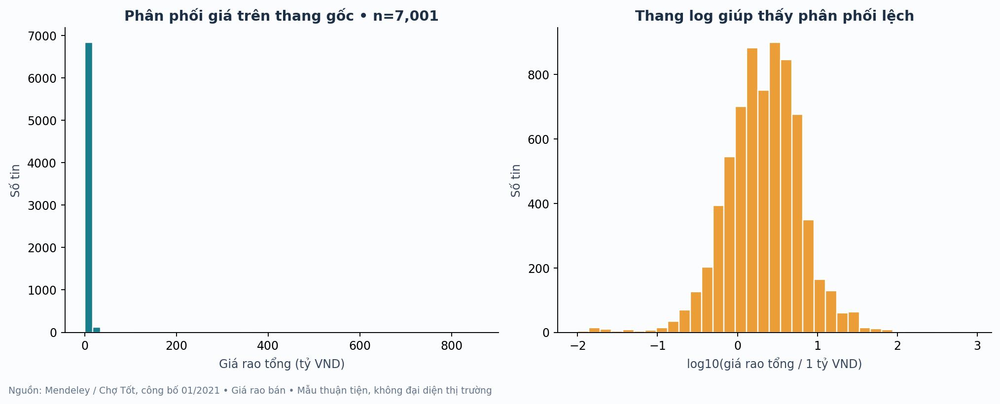
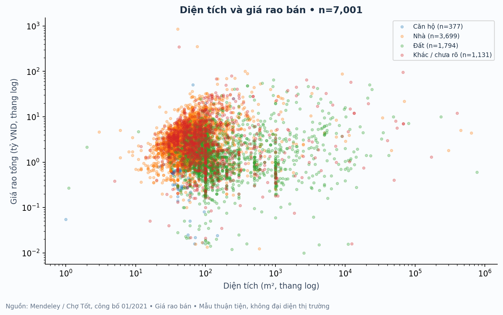
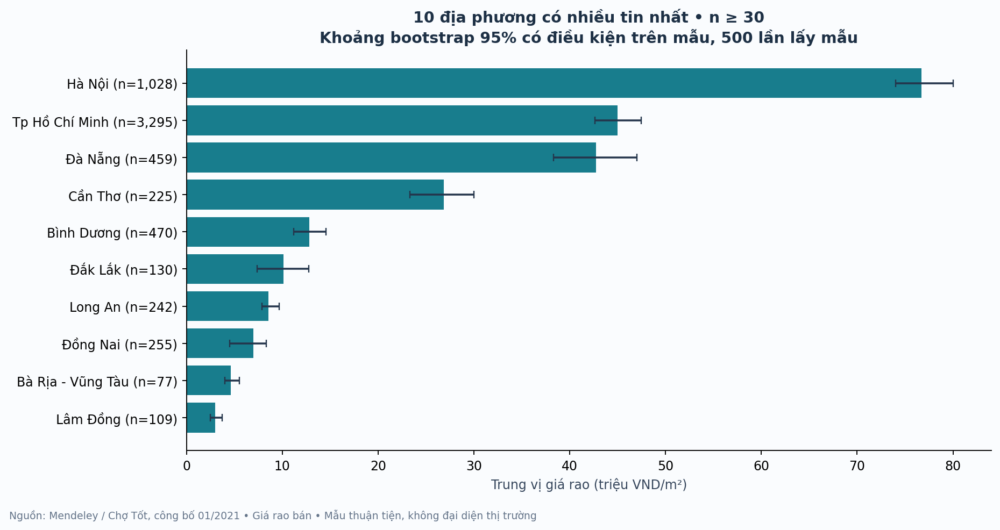
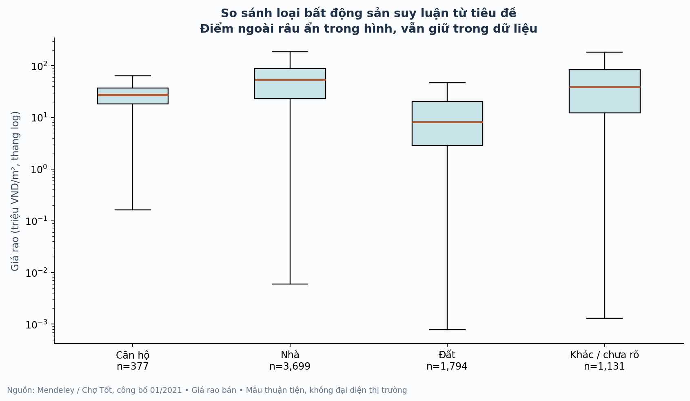
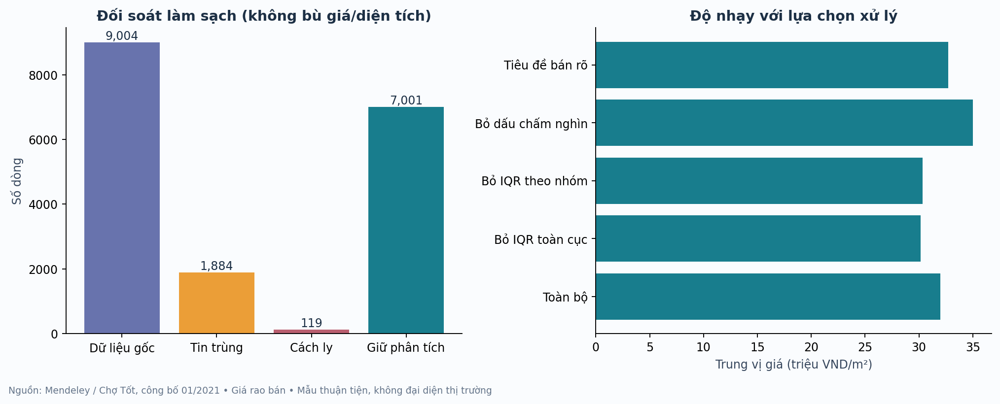
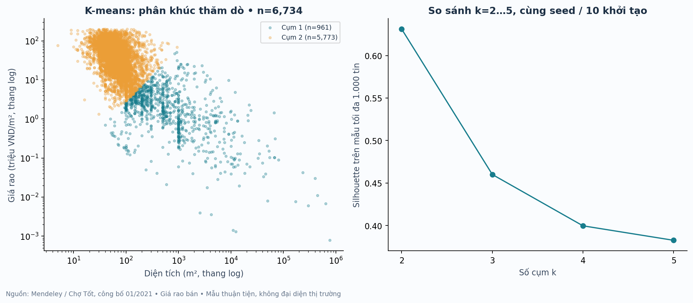

# Phân tích giá rao bất động sản Việt Nam

ĐỒ ÁN NHẬP MÔN KHOA HỌC DỮ LIỆU

Xây dựng dữ liệu và xử lý chất lượng để trực quan hóa và rút ra ý nghĩa

Đề tài xử lý và trực quan hóa bất động sản tại STT 22 hoặc 47. Nhóm xác nhận số đăng ký cụ thể với giảng viên trước khi nộp.

| Thành viên | Mã số sinh viên |
| --- | --- |
| Võ Văn Đạt | N23DCCN078 |
| Nguyễn Thị Yến Nhi | N23DCCN112 |
| Hứa Như Quỳnh | N23DCCN118 |

Trường và khoa  [Nhóm bổ sung]
Lớp học phần  [Nhóm bổ sung]
Giảng viên hướng dẫn  [Nhóm bổ sung]
Ngày nộp  [Nhóm bổ sung]

Bản thảo có kết quả được tạo từ dữ liệu thực và code đã chạy. Nhóm cần đọc code, kiểm tra mẫu thủ công, thực hiện phần cải tiến được phân công và cập nhật báo cáo trước khi nộp. Không ghi nhận các công việc cải tiến chưa thực hiện thành kết quả đã có.

Nguồn dữ liệu công bố ngày 12 tháng 1 năm 2021. Bản phân tích được chuẩn bị ngày 15 tháng 10 năm 2026; ngày chuẩn bị không phải thời điểm giá thị trường.

## Tóm tắt đồ án và cấu trúc báo cáo

Đồ án xây dựng quy trình tái lập để phân tích một mẫu tin rao bất động sản Việt Nam từ Mendeley Data. Từ 9.004 dòng nguồn, quy trình giữ 7.001 tin, gộp 1.884 dòng lặp theo khóa nội dung và cách ly 119 dòng cần kiểm chứng. Trung vị giá rao là 2,20 tỷ đồng, trung vị diện tích 70 m² và trung vị đơn giá 32,00 triệu đồng/m². Các con số mô tả mẫu được giữ, không ước lượng giá của toàn thị trường.

Giá trị chính của đồ án nằm ở quy tắc xử lý được giải thích, nhật ký truy xuất từng dòng, biểu đồ có mẫu số và đơn vị, cùng phân tích độ nhạy. Bảng Excel có công thức và biểu đồ chỉnh sửa được; dashboard ngoại tuyến cho phép lọc và xuất dữ liệu. Phần mở rộng gồm K-means được lập trình bằng NumPy và minh họa index trên database SQLite đã tạo thực tế.

Kết quả cần được đọc theo ba giới hạn. Dữ liệu lịch sử không có ngày từng tin. Nhiều tiêu đề không nêu rõ loại giao dịch hoặc loại bất động sản. Một số trường chi tiết có dấu hiệu bị lẫn giữa các bản ghi nên được loại khỏi các phân tích chính. Những giới hạn này được giữ trong diễn giải và đề xuất cải tiến.

### Các phần của báo cáo

Chương 1 Bài toán và phạm vi

Chương 2 Nguồn dữ liệu và từ điển biến

Chương 3 Chuẩn bị dữ liệu và kiểm chứng

Chương 4 Trực quan hóa và kết quả

Chương 5 Mở rộng phân cụm và SQL

Chương 6 Kết luận và giới hạn

Tài liệu tham khảo

Phụ lục Tái lập và phân công

## Chương 1 Bài toán và phạm vi

### 1 1 Mục tiêu và câu hỏi phân tích

Bài toán xuất phát từ việc tin rao có nhiều cách ghi giá, diện tích và loại hình, khiến so sánh trực tiếp dễ sai. Mục tiêu là tạo tập dữ liệu có thể kiểm tra, mô tả phân bố giá rao và xác định những mối liên hệ đáng tìm hiểu thêm.

Giá rao và đơn giá trong mẫu có phân bố như thế nào, trung bình có bị kéo bởi phần đuôi giá cao hay không?

Diện tích liên hệ với tổng giá rao như thế nào khi mẫu gồm cả đất, nhà và căn hộ?

Các nhóm địa phương và loại bất động sản khác nhau ra sao về trung vị đơn giá, độ phân tán và số tin?

Kết luận thay đổi bao nhiêu nếu bỏ ngoại lệ, bỏ cách ghi diện tích mơ hồ hoặc chỉ giữ tiêu đề bán rõ?

### 1 2 Phạm vi và sản phẩm

Đơn vị quan sát là bản ghi tin quảng cáo. “Tin sau gộp trùng” không đồng nghĩa “bất động sản duy nhất” vì nguồn không có mã tin ổn định hay xác nhận giao dịch. Đồ án không xây dựng hệ thống dự đoán giá nhà; đó là hướng đề tài khác trong danh sách đăng ký.

Phần bắt buộc gồm dữ liệu gốc, dữ liệu đã xử lý, nhật ký làm sạch, các bảng thống kê, biểu đồ, Excel, dashboard và bản thảo báo cáo. Các phần mở rộng được thực hiện bằng code và database để có bằng chứng chạy thực tế khi trình bày.

### 1 3 Liên hệ nội dung môn học

| Chương môn học | Áp dụng trong đồ án |
| --- | --- |
| Chương 1 | Xác định câu hỏi, quy trình và tri thức rút ra từ dữ liệu |
| Chương 2 | Kiểm tra thiếu, trùng, nhất quán, đơn vị, ngoại lệ và chuẩn hóa |
| Chương 3 | Histogram, scatter, cột và nguyên tắc nhãn trục |
| Chương 4 mở rộng | K-means thăm dò trên dữ liệu đã biến đổi và chuẩn hóa |
| Chương 5 mở rộng | Mô hình quan hệ, truy vấn JOIN, chỉ mục và kế hoạch truy vấn |

Chi tiết tên file và trang PDF nằm trong references/DOI_CHIEU_SLIDE.md. IQR, boxplot, Spearman, bootstrap, silhouette và ARI là kiến thức bổ sung; không trình bày như nội dung được giảng chi tiết trong slide.

## Chương 2 Nguồn dữ liệu và từ điển biến

### 2 1 Nguồn và khả năng truy xuất

Vietnam Real Estate Data phiên bản 2 được Duc Chung Tran, Huy Hoang Nguyen và Hong Son Ha công bố trên Mendeley Data ngày 12/01/2021, giấy phép CC BY 4.0, DOI 10.17632/5477zhnmn2.2. File chotot_data.json có 24.292.489 byte. SHA-256 tính tại máy khớp manifest công khai của nguồn.

Mô tả nguồn ghi khoảng 10.000 bài đăng nhưng file thực tế có 9.004 dòng và hợp của 29 tên trường. Đồ án sử dụng số đếm thực tế, không bổ sung dữ liệu giả. Metadata và manifest được lưu cạnh file nguồn; script tải lại kiểm tra checksum trước khi lưu.

Nguồn không nêu quy trình lấy mẫu có xác suất, không cung cấp ngày từng tin, tọa độ hay nhãn giá giao dịch đã kiểm chứng. Vì vậy không kết luận xu hướng theo thời gian, không dựng bản đồ căn nhà chính xác và không diễn giải dữ liệu thành thị trường hiện tại.

### 2 2 Năm trường nguồn được sử dụng

| Trường | Vai trò | Quy tắc |
| --- | --- | --- |
| title | Nhận diện loại và giao dịch | Quy tắc từ khóa; giữ nhóm chưa rõ |
| price | Giá rao và đôi khi diện tích | Đọc đơn vị tỷ, triệu, đồng; không tự sửa đơn vị |
| area | Diện tích chính | Chuẩn hóa m²; có thể phục hồi từ price nếu rõ |
| location | Nhóm địa phương lịch sử | Danh mục và alias có kiểm soát; không suy từ tên đường |
| description | Khóa gộp trùng bảo thủ | Không trích thông tin cá nhân vào bảng sạch |

Các trường số phòng, pháp lý, nội thất và diện tích chi tiết không dùng làm kết luận chính: quan sát thấy chúng lặp kéo dài giữa các tin thuộc loại khác nhau. Đây là dấu hiệu chất lượng cần xác minh, chưa phải kết luận đã chứng minh về cách tác giả thu thập.

## Từ điển dữ liệu phân tích

| Biến | Ý nghĩa và đơn vị |
| --- | --- |
| row_id | Số thứ tự dòng gốc, bắt đầu từ 1, phục vụ kiểm chứng nội bộ |
| listing_id | 20 ký tự đầu SHA-256 của 5 trường lõi chuẩn hóa |
| province | Tên địa phương lịch sử sau chuẩn hóa alias; Chưa xác định khi không xác định |
| district | Quận huyện được nhận diện bằng tiền tố; Chưa xác định nếu không đủ bằng chứng |
| property_type | land, house, apartment hoặc other_unknown, suy luận từ tiêu đề |
| transaction_status | sale, sale_assumed, sale_with_rental_income; các loại thuê hoặc mơ hồ được cách ly |
| area_m2 | Diện tích m² dương, không thay thiếu bằng trung bình |
| sale_price_vnd | Tên kỹ thuật của giá rao tổng bằng đồng; không xác nhận đã bán |
| price_per_m2_vnd | Giá rao tổng chia diện tích; đồng/m² |
| price_basis và area_source | Giá tổng hay giá/m²; nguồn phục hồi diện tích nếu có |
| quality_flags | Các cờ suy luận loại, giả định bán, cách ghi số và địa lý |
| is_outlier_global và is_outlier_group | Cờ IQR đơn giá theo toàn bộ và theo nhóm tham chiếu |
| iqr_group | Nhóm tham chiếu dùng xác định ngưỡng IQR |
| cluster | Nhãn cụm thăm dò; -1 nếu ngoại lệ không tham gia huấn luyện |
| area_band | Nhóm diện tích với khoảng biên được công khai |

Bảng sạch không chứa tiêu đề, mô tả, số liên hệ và địa chỉ đường cụ thể. File nguồn nguyên trạng vẫn có nội dung công khai của tin; khi chia sẻ rộng, ưu tiên tập đã xử lý và ghi công nguồn.

Đơn giá được tính ở từng tin rồi lấy trung vị. Trung vị của các tỷ số không bằng tỷ số của hai trung vị; cũng không bằng tổng giá chia tổng diện tích. Excel và dashboard ghi riêng đơn vị tỷ đồng cho tổng giá và triệu đồng/m² cho đơn giá.

## Chương 3 Chuẩn bị dữ liệu và kiểm chứng

### 3 1 Quy trình xử lý

Dữ liệu nguồn nguyên trạng → kiểm tra checksum → chuẩn hóa chuỗi → gộp trùng nội dung → đọc diện tích và giá → xác định giao dịch → cách ly lỗi chưa kiểm chứng → chuẩn hóa địa phương → tạo đơn giá → gắn cờ IQR → thống kê và biểu đồ → phân cụm và database.

Chuỗi được chuẩn hóa Unicode NFKC, khoảng trắng và chữ hoa chữ thường khi tạo khóa trùng. Một dòng chỉ được gộp nếu cả title, price, area, location và description sau chuẩn hóa đều giống nhau. Khóa này bảo thủ hơn chỉ so sánh bốn trường; cùng căn nhà có nội dung khác vẫn có thể còn trong mẫu.

| Trạng thái | Số dòng | Ý nghĩa |
| --- | --- | --- |
| Nguồn đầu vào | 9.004 | Mẫu số gốc |
| Trùng khóa năm trường | 1.884 | Giữ dòng đại diện và ánh xạ về row_id |
| Cách ly để kiểm chứng | 119 | Có thể có nhiều lý do trên một dòng |
| Giữ phân tích | 7.001 | Giá và diện tích đọc được, đạt quy tắc |

Đối soát: 9.004 = 1.884 + 119 + 7.001. row_lineage.csv có đúng một bản ghi cho mỗi dòng nguồn. listings_rejected.csv ghi các lý do để nhóm kiểm chứng lại, thay vì xóa mất bằng chứng.

### 3 2 Thiếu nội dung và thiếu thông tin hữu dụng

Năm trường nguồn đều có nội dung, nhưng chuỗi không rỗng chưa chắc đọc được thành số. Sau kiểm tra các khóa duy nhất, có 2 trường hợp không xác định được diện tích. 351 tin được giữ đã phục hồi diện tích từ phần m² được ghi rõ trong price. Quy trình không bù giá hoặc diện tích bằng trung bình, vì như vậy sẽ tạo quan sát giả và làm thay đổi phân bố giá.

## Quy tắc chuẩn hóa và xử lý ngoại lệ

### 3 3 Quy tắc và trường hợp cần kiểm chứng

| Vấn đề | Cách xử lý |
| --- | --- |
| Giá tỷ hoặc triệu | Nhân hệ số đơn vị được ghi rõ để tạo giá bằng đồng |
| Giá ghi rõ trên m² | Nhân diện tích để tạo tổng giá và lưu price_basis |
| Dấu phẩy và dấu chấm | Quy ước số Việt Nam; đánh cờ dấu chấm có 3 chữ số sau nó |
| Dấu gạch trước diện tích | Chỉ coi dấu gạch có khoảng trắng đầu chuỗi là phân cách |
| Giá tổng dưới 10 triệu đồng | Cách ly theo ngưỡng rà soát đã công khai, không tự nhân thêm |
| Tiêu đề thuê hoặc bán thuê mơ hồ | Cách ly khỏi thống kê bán |
| Tiêu đề trả trước hoặc trả góp | Cách ly khi chưa xác định đó là tổng giá |
| Địa phương không đúng danh mục | Gán Chưa xác định; không đưa tên đường vào cột tỉnh |
| Loại hình không đủ từ khóa | Giữ other_unknown để thấy giới hạn phân loại |

Ngưỡng 10 triệu đồng là lựa chọn rà soát của đồ án, không phải định luật về giá bất động sản. Các tin bị cách ly có thể gồm dữ liệu đúng hoặc giá nhập sai; nhóm cần kiểm chứng trước khi phục hồi. Một tin có thể bị gắn nhiều lý do nên tổng số lý do có thể vượt số tin bị loại.

### 3 4 IQR và chuẩn hóa cho phân cụm

IQR được tính trên đơn giá. Ngưỡng dưới là Q1 trừ 1,5 lần IQR; ngưỡng trên là Q3 cộng 1,5 lần IQR. Ưu tiên nhóm địa phương và loại có ít nhất 30 tin; nếu nhỏ hơn, dùng nhóm loại, rồi toàn mẫu nếu cần. 267 tin được gắn cờ theo nhóm và vẫn được giữ trong EDA mặc định. Không coi mọi ngoại lệ là lỗi.

K-means sử dụng log tự nhiên của diện tích và đơn giá rồi chuẩn hóa Z-score với độ lệch chuẩn tổng thể. Log giảm ảnh hưởng của phân bố lệch; Z-score giúp hai biến không bị chênh thang đo. Các tham số biến đổi được lưu trong analysis.json. EDA trên thang log luôn ghi rõ trên trục.

## Chương 4 Trực quan hóa và kết quả

### 4 1 Phân bố giá rao

Hình 1 Phân bố tổng giá rao trên thang gốc và log với 7.001 tin

Giá rao trung bình là 3,90 tỷ đồng, cao hơn trung vị 2,20 tỷ đồng. Đơn giá trung bình là 54,73 triệu đồng/m², trong khi trung vị là 32,00 triệu đồng/m². Chênh lệch này cùng phần đuôi ở hình gợi ý phân bố lệch phải; trung vị là mô tả trung tâm phù hợp hơn khi so sánh nhóm.

Histogram thang gốc giữ các giá trị cao để thấy mức độ lệch; histogram log làm rõ vùng tập trung mà không xóa quan sát. Hai cách nhìn bổ sung cho nhau. Các giá cực cao vẫn cần kiểm tra tính đúng đắn trước khi diễn giải.

Trong dashboard, histogram đơn giá dùng khoảng nhóm không đều và cột cuối từ 200 triệu đồng/m² trở lên. Chiều cao biểu diễn số tin theo nhóm, không phải mật độ xác suất trên mỗi đơn vị bề rộng.

## Diện tích và tổng giá rao

Hình 2 Quan hệ diện tích và tổng giá theo loại suy luận với hai trục logarit

Tương quan Spearman giữa diện tích và tổng giá trong toàn mẫu là -0,045, gần 0. Vì mẫu trộn nhiều loại và khu vực, kết quả không ủng hộ một kết luận đơn giản rằng cứ diện tích lớn thì tổng giá cao hơn trên toàn bộ dữ liệu. Đất ở khu vực đơn giá thấp có thể có diện tích lớn hơn nhà đô thị. Đây là diễn giải cần kiểm tra theo từng nhóm, chưa chứng minh cơ chế gây ra giá.

Tương quan diện tích với đơn giá là -0,591. Đơn giá chứa diện tích ở mẫu số nên có liên hệ toán học với diện tích; không dùng riêng hệ số này để kết luận tác động nhân quả. Hình tương quan bổ sung nằm tại outputs/charts/08_spearman_correlation.png.

Dashboard hiển thị mẫu cách đều tối đa khoảng 1.800 điểm để tương tác mượt; ghi rõ số điểm được vẽ. Các KPI, bảng nhóm và CSV xuất dùng toàn bộ tập đã lọc. Hình tĩnh trong báo cáo dùng toàn bộ tin được giữ.

## So sánh địa phương và độ phủ mẫu

Hình 3 Trung vị đơn giá của 10 địa phương có nhiều tin nhất và khoảng bootstrap có điều kiện trên mẫu

| Địa phương | Số tin | Trung vị triệu đồng/m² |
| --- | --- | --- |
| Tp Hồ Chí Minh | 3.295 | 45,00 |
| Hà Nội | 1.028 | 76,73 |
| Bình Dương | 470 | 12,83 |
| Đà Nẵng | 459 | 42,76 |
| Đồng Nai | 255 | 7,00 |

Tp Hồ Chí Minh chiếm 47,1% số tin được giữ. Vì độ phủ không đều, thứ hạng chỉ phản ánh mẫu này. Khi so sánh giá, cần lọc cùng loại và đọc số tin; không gọi địa phương đứng đầu mẫu là nơi đắt nhất cả nước.

Khoảng bootstrap dùng 500 lần lấy mẫu lại để mô tả độ bất định của trung vị có điều kiện trên mẫu. Nó không khắc phục sai lệch lựa chọn và giả định độc lập giữa tin có thể không đúng. Dashboard chọn tối đa 10 nhóm theo trung vị trong các nhóm đạt 30 tin, còn hình này chọn theo độ phủ; tiêu chí chọn được ghi rõ.

## So sánh theo loại bất động sản

Hình 4 Độ phân tán đơn giá theo loại suy luận từ tiêu đề

| Loại suy luận | Số tin | Diện tích trung vị m² | Đơn giá trung vị triệu/m² |
| --- | --- | --- | --- |
| Nhà | 3.699 | 57,0 | 54,75 |
| Đất | 1.794 | 115,0 | 8,23 |
| Khác hoặc chưa rõ | 1.131 | 76,0 | 39,02 |
| Căn hộ | 377 | 61,0 | 27,69 |

Khác biệt giữa các loại cho thấy gộp tất cả bất động sản vào một mức giá trung tâm có thể che mất cơ cấu mẫu. Đây là loại suy luận tự động, chưa được kiểm định nhãn bằng mẫu do con người gán; nhóm phải thực hiện bước này khi cải tiến.

Hình tĩnh dùng boxplot tiêu chuẩn và ẩn các điểm ngoài râu để dễ đọc, nhưng không xóa chúng khỏi dữ liệu. Dashboard dùng Q1, trung vị, Q3 với hai đầu P10–P90 được ghi rõ, giúp tránh nhầm hai quy ước đồ thị.

## Phân tích độ nhạy của kết quả

Hình 5 Đối soát dòng và thay đổi trung vị theo lựa chọn xử lý

| Kịch bản | Số tin | Triệu đồng/m² | Thay đổi so với gốc |
| --- | --- | --- | --- |
| Giữ toàn bộ | 7.001 | 32,00 | 0,00% |
| Bỏ IQR toàn cục | 6.761 | 30,18 | -5,70% |
| Bỏ IQR theo nhóm | 6.734 | 30,33 | -5,23% |
| Bỏ dấu chấm nghìn | 6.654 | 35,00 | 9,38% |
| Tiêu đề bán rõ | 3.055 | 32,70 | 2,19% |

Bỏ các tin có dấu chấm nghìn làm trung vị đơn giá thay đổi 9,38%. Đây là thay đổi đáng quan tâm và là lý do cần kiểm chứng cách ghi số trên mẫu thủ công. Bỏ IQR theo nhóm chỉ là một kịch bản so sánh; không mặc định làm dữ liệu “đúng hơn”.

3.931 tin được suy đoán là bán theo ngữ cảnh tập dữ liệu nhưng tiêu đề không nêu bán rõ. Vì tỷ lệ này lớn, báo cáo trình bày thêm mẫu chỉ tiêu đề bán rõ và giữ cờ để người đọc đánh giá lựa chọn.

## Chương 5 Mở rộng phân cụm và SQL

### 5 1 Phân khúc thăm dò bằng K means

Hình 6 Phân cụm và so sánh silhouette với k từ 2 đến 5

Code NumPy thực hiện khởi tạo K-means++, gán điểm theo khoảng cách Euclid và cập nhật tâm bằng trung bình. Mỗi k chạy 10 khởi tạo, tối đa 150 vòng, seed 20261015. Mẫu huấn luyện có 6.734 tin sau khi tạm loại cờ IQR theo nhóm; phần EDA vẫn giữ các tin này. Trong k từ 2 đến 5, k=2 đạt silhouette trên mẫu cố định 1.000 tin cao nhất.

| k | Silhouette mẫu | Inertia | Cụm nhỏ nhất |
| --- | --- | --- | --- |
| 2 | 0,631 | 6.262,8 | 961 |
| 3 | 0,460 | 3.879,4 | 474 |
| 4 | 0,400 | 3.010,3 | 326 |
| 5 | 0,383 | 2.493,6 | 126 |

Silhouette là tiêu chí nội tại, được ước lượng trên mẫu con cố định và không thay thế kiểm chứng nghiệp vụ. Phân cụm chứa đơn giá nên mô tả chính giá đã biết, không dự đoán giá của bất động sản mới.

## Diễn giải cụm và minh họa cơ sở dữ liệu

| Cụm | Số tin | Diện tích m² | Giá tỷ đồng | Triệu đồng/m² |
| --- | --- | --- | --- | --- |
| 1 | 961 | 500,0 | 0,85 | 2,00 |
| 2 | 5.773 | 64,0 | 2,35 | 38,67 |

Các giá trị trong bảng là trung vị từng biến của cụm, không phải tọa độ tâm cụm đã biến đổi. Cụm diện tích lớn và đơn giá thấp gợi ý một nhóm tin khác về quy mô so với cụm diện tích nhỏ và đơn giá cao hơn. Không đặt tên “đầu tư tốt” hoặc “định giá hợp lý” vì không có giao dịch, lợi suất hay nhãn chuẩn để xác minh.

Kiểm tra bổ sung với seed 7 và 42, mỗi seed 10 khởi tạo, cho ARI bằng 1,0 so với phân hoạch chính. Hai lần thử này cho thấy phân hoạch ổn định trước thay đổi khởi tạo đã thử; chúng không chứng minh cụm đúng về nghiệp vụ hoặc sẽ ổn định khi đổi nguồn và cách chọn biến.

### 5 2 Database và truy vấn SQL

Database outputs/real_estate.sqlite được tạo thực với 7.001 tin. Bảng provinces và property_types lưu khóa số và tên; listings tham chiếu chúng bằng khóa ngoại. Các ràng buộc kiểm tra diện tích dương, tổng giá đạt ngưỡng rà soát và đơn giá nhất quán với giá chia diện tích. PRAGMA integrity_check trả về ok; kiểm tra khóa ngoại không có lỗi.

| File SQL | Bằng chứng |
| --- | --- |
| 01_schema.sql | DDL tạo 3 bảng với khóa chính, khóa ngoại và CHECK |
| 02_queries.sql | JOIN, GROUP BY, HAVING, lọc ngoại lệ và truy vấn tham số |
| 03_indexes.sql | Chỉ mục ghép theo địa phương, loại, đơn giá và mã dòng |

Các truy vấn dùng AVG được đặt tên là mean, không gọi là median. Các bảng trung vị được tính trong Python. Dùng tham số cho điều kiện tìm kiếm để tránh ghép chuỗi dữ liệu vào SQL.

CREATE INDEX idx_listings_search
ON listings(province_id, type_id, price_per_m2_vnd, row_id);

Đây là minh họa SQL bổ sung theo Chương 5, không phải tuyên bố đã xử lý hệ thống dữ liệu lớn hoặc triển khai database sản xuất.

## Đo truy vấn trước và sau chỉ mục

Thí nghiệm dùng SQLite 3.50.4, cùng kết nối, cùng câu SELECT và cùng tham số. Truy vấn lọc địa phương Tp Hồ Chí Minh, loại Nhà, khoảng đơn giá rồi sắp xếp và lấy tối đa 100 tin. Mỗi giai đoạn khởi động 10 lần, đo 51 lần trên bộ nhớ đệm đã ấm; thống kê trung vị cùng P10–P90.

| Giai đoạn | Trung vị ms | P10 ms | P90 ms | Số dòng |
| --- | --- | --- | --- | --- |
| Trước index | 2,0703 | 1,5666 | 5,7908 | 100 |
| Sau index | 0,5667 | 0,5394 | 0,6286 | 100 |

Tỷ số thời gian trung vị trước/sau ở lần chạy được lưu là 3,65 lần. Đây là số đo tại máy trên truy vấn đã chọn; thời gian sẽ đổi theo tải máy, bộ nhớ đệm và độ chọn lọc. Không suy rộng thành tốc độ cải thiện trên mọi truy vấn hay dữ liệu lớn.

### Kế hoạch thực thi

Trước chỉ mục

SCAN listings

USE TEMP B-TREE FOR ORDER BY

Sau chỉ mục

SEARCH listings USING INDEX idx_listings_search (province_id=? AND type_id=? AND price_per_m2_vnd>? AND price_per_m2_vnd<?)

Việc chuyển từ quét bảng và cây tạm cho ORDER BY sang tìm kiếm bằng chỉ mục là bằng chứng cơ chế, bên cạnh thời gian. Index làm tăng kích thước lưu trữ và chi phí ghi; không tạo index cho mọi cột chỉ vì một truy vấn chạy nhanh hơn.

Hai giai đoạn trả cùng số dòng và cùng SHA-256 của toàn bộ kết quả đã sắp xếp. Hash được lưu trong outputs/sql_benchmark.json để kiểm tra rằng tối ưu không đổi ý nghĩa truy vấn.

Thiết kế hiện tại đo trước rồi sau index, chưa đảo thứ tự nhiều vòng và chưa đo chi phí INSERT hoặc kích thước index. Đây là thí nghiệm cải tiến phù hợp cho thành viên phụ trách SQL, cần trình bày là việc đề xuất nếu chưa làm.

## Chương 6 Kết luận và giới hạn

### 6 1 Kết quả đáp ứng mục tiêu

Đồ án đã tạo tập 7.001 tin có đơn vị nhất quán, nhật ký đối soát nguồn và quy trình chạy lại. Thống kê cho thấy giá rao phân bố lệch, trung bình cao hơn trung vị và khác biệt rõ theo loại suy luận. Độ phủ địa phương không đều; tương quan diện tích và tổng giá gần 0 trên mẫu gộp cho thấy cần phân tích theo nhóm thay vì áp một quan hệ đơn giản cho tất cả tin.

Phân tích độ nhạy cho thấy lựa chọn xử lý có ảnh hưởng đo được, đặc biệt cách diễn giải dấu chấm trong diện tích. K-means cung cấp cách mô tả nhóm thăm dò và SQL minh họa được database, kế hoạch thực thi và đo thời gian bằng dữ liệu thực.

### 6 2 Giới hạn ảnh hưởng đến kết luận

Nguồn là mẫu tin rao lịch sử không có ngày từng tin, không có thiết kế lấy mẫu đại diện và không xác nhận giao dịch.

Gộp trùng dựa nội dung không xác định được tất cả bài đăng về cùng căn nhà hoặc cùng môi giới; các quan sát có thể phụ thuộc nhau.

Quy tắc loại hình và giao dịch chưa được đánh giá bằng nhãn con người. Các tin không rõ giao dịch và cách ghi số mơ hồ còn ảnh hưởng kết quả.

Diện tích là diện tích rao đăng, chưa bảo đảm cùng khái niệm diện tích đất hoặc sàn giữa các loại; so sánh đơn giá chéo loại cần thận trọng.

Ngưỡng cách ly và IQR là lựa chọn phân tích, cần kiểm chứng thủ công và báo cáo độ nhạy.

Bootstrap, tương quan và silhouette không khắc phục được sai lệch nguồn. Đơn giá là biến dẫn xuất nên một số tương quan có liên hệ toán học.

Kết quả SQL thuộc mẫu nhỏ và một truy vấn lọc đã chọn. Phân cụm không phải mô hình định giá hoặc hệ khuyến nghị được kiểm định.

### 6 3 Hướng cải tiến có thể kiểm chứng

Ưu tiên gán nhãn thủ công một mẫu phân tầng cho loại hình và giao dịch; đối chiếu các giá thấp và cách ghi diện tích mơ hồ; bổ sung so sánh cùng loại trong từng địa phương. Sau đó thử nhiều seed và cách chuẩn hóa cho phân cụm, đo SQL theo nhiều độ chọn lọc và thứ tự A/B. Chỉ thêm dữ liệu có thời gian hoặc tọa độ khi xác định được nguồn và quyền sử dụng, không tự tạo các trường còn thiếu.

## Tài liệu tham khảo

Tran, D. C., Nguyen, H. H., & Ha, H. S. (2021). Vietnam Real Estate Data (Version 2) [Data set]. Mendeley Data. https://doi.org/10.17632/5477zhnmn2.2. CC BY 4.0. Truy cập 15/10/2026.

Tài liệu môn học. Chuong 1 - Mo dau.pdf, 34 trang. Chương 1: câu hỏi và quy trình phân tích.

Tài liệu môn học. Chuong 2 - Chuan bi du lieu.pdf, 31 trang. Trang 6–10, 13–17 và 28–29: thiếu, ngoại lệ, nhất quán, chuẩn hóa, biến dẫn xuất.

Tài liệu môn học. Chuong 3 - Truc quan hoa du lieu.pdf, 40 trang. Trang 14–18, 22–30: cột, scatter, histogram và thiết kế nhãn.

Tài liệu môn học. Chương 4 - Hoc may - 2.pdf, 65 trang. Trang 48–53: K-means.

Tài liệu môn học. Chuong 5 - Co so du lieu va SQL - 1.pdf, trang 36–38: index. Chuong 5 - Co so du lieu va SQL - 2.pdf, trang 36–40: tối ưu JOIN.

SQLite. EXPLAIN QUERY PLAN. https://www.sqlite.org/eqp.html. Tài liệu chính thức về đọc kế hoạch truy vấn.

SQLite. Query Planning. https://www.sqlite.org/queryplanner.html. Tài liệu chính thức về tìm kiếm và sắp xếp bằng chỉ mục.

Rousseeuw, P. J. (1987). Silhouettes: A graphical aid to the interpretation and validation of cluster analysis. Journal of Computational and Applied Mathematics, 20, 53–65. https://doi.org/10.1016/0377-0427(87)90125-7.

Số trang slide là số trang PDF bắt đầu từ 1, không phải số trang hiển thị có thể khác trên slide. DOI_CHIEU_SLIDE.md đối chiếu từng phần và phân biệt kỹ thuật mở rộng. Những nội dung không dùng trong đồ án như Naive Bayes hoặc hệ khuyến nghị không được gán thêm chỉ để bao phủ chương.

## Phụ lục Giải thích các kỹ thuật bổ sung

### A Tứ phân vị IQR và boxplot

Q1 và Q3 là phân vị 25% và 75%; IQR là hiệu Q3 trừ Q1. Quy tắc 1,5 lần IQR đánh dấu các quan sát nằm ngoài khoảng tham chiếu. Nó phát hiện giá trị xa phần giữa của phân bố, không xác nhận giá trị sai. Boxplot tĩnh dùng hộp Q1–Q3, trung vị và râu tới quan sát xa nhất còn trong ngưỡng 1,5 IQR; dashboard ghi rõ dùng P10–P90. Tham khảo NIST Engineering Statistics Handbook, mục Box Plot: https://www.itl.nist.gov/div898/handbook/eda/section3/boxplot.htm.

### B Spearman và bootstrap

Spearman đo mức liên hệ đơn điệu bằng tương quan Pearson trên thứ hạng. Code lấy thứ hạng trung bình khi có giá trị bằng nhau rồi tính tương quan. Hệ số gần 0 không loại trừ quan hệ phi tuyến hoặc quan hệ khác nhau giữa các nhóm. Tham khảo tài liệu pandas DataFrame.corr: https://pandas.pydata.org/docs/reference/api/pandas.DataFrame.corr.html.

Bootstrap trong đồ án lấy mẫu lại có hoàn lại cùng cỡ với mỗi nhóm, tính trung vị 500 lần, rồi lấy phân vị 2,5% và 97,5% của các trung vị. Đây là khoảng percentile 95% có điều kiện trên mẫu. Nó dựa vào giả định các quan sát có thể xem là độc lập và không sửa sai lệch lấy mẫu. Tham khảo cách xây dựng percentile trong SciPy bootstrap: https://docs.scipy.org/doc/scipy/reference/generated/scipy.stats.bootstrap.html. Code của đồ án tự tính bằng NumPy, không gọi SciPy.

### C Silhouette inertia và ARI

Với mỗi điểm, silhouette so sánh khoảng cách trung bình tới các điểm cùng cụm với khoảng cách trung bình nhỏ nhất tới một cụm khác. Lấy hiệu khoảng cách ngoài cụm trừ trong cụm rồi chia cho giá trị lớn hơn của hai khoảng cách; điểm đơn lẻ được gán 0. Đồ án lấy mẫu cố định tối đa 1.000 tin để tính, sau đó so sánh k từ 2 đến 5 trên cùng mẫu. Giá trị cao hơn gợi ý cụm tách rõ hơn theo khoảng cách đang dùng.

Inertia là tổng bình phương khoảng cách từ điểm tới tâm cụm được gán; nó thường giảm khi tăng k nên không chọn k chỉ bằng giá trị nhỏ nhất. ARI so sánh hai phân hoạch qua các cặp quan sát và điều chỉnh mức đồng thuận ngẫu nhiên, không phụ thuộc tên nhãn cụm. ARI bằng 1 nghĩa là hai phân hoạch trùng nhau. Tham khảo tài liệu chính thức về đánh giá phân cụm: https://scikit-learn.org/stable/modules/clustering.html#clustering-performance-evaluation. Đồ án triển khai NumPy, không phụ thuộc scikit-learn.

## Phụ lục Tái lập và phân công

### A Các bước tái lập

python scripts/download_data.py
python src/pipeline.py
python tools/build_dashboard.py
python tools/build_report.py
python -m unittest discover -s tests -v

Tạo môi trường và cài requirements.txt trước khi chạy. Dữ liệu đã tải nên không cần mạng cho phân tích. Excel cần runtime Node và @oai/artifact-tool để tạo lại; file bàn giao mở độc lập trong Excel. Hướng dẫn chi tiết nằm trong README.md.

| Thành viên | Trọng tâm kiểm chứng và cải tiến | Phần báo cáo |
| --- | --- | --- |
| Võ Văn Đạt
N23DCCN078 | Pipeline và tái lập; phân cụm; SQL và benchmark; tích hợp kết quả | Chương 1 và 5; phụ lục chạy lại |
| Nguyễn Thị Yến Nhi
N23DCCN112 | Nguồn và giấy phép; đọc giá diện tích; kiểm tra thủ công; trùng và độ nhạy | Chương 2 và 3 |
| Hứa Như Quỳnh
N23DCCN118 | Biểu đồ và bộ lọc; phân tích theo nhóm; diễn giải; hoàn thiện báo cáo | Chương 4 và 6; định dạng và tài liệu tham khảo |

Phân công chi tiết gồm sản phẩm, tiêu chí nghiệm thu, đối chiếu chéo và kế hoạch tương đối theo ngày nộp trong docs/PHAN_CONG_VA_NOI_DUNG_BAO_CAO.md. Kịch bản trình bày và câu hỏi bảo vệ nằm trong docs/KICH_BAN_THUYET_TRINH_VA_HOI_DAP.md.

### B Bằng chứng cần bổ sung trước khi nộp

Nhóm bổ sung nhật ký kiểm chứng thủ công, kết quả thí nghiệm cải tiến thực sự đã làm, ảnh chụp demo trên máy nhóm, thông tin học phần và xác nhận STT đăng ký. Không ghi số điểm kỳ vọng hoặc cam kết kết quả chấm. Tất cả con số trong báo cáo phải cập nhật lại từ lần chạy cuối sau khi thay đổi quy tắc.
