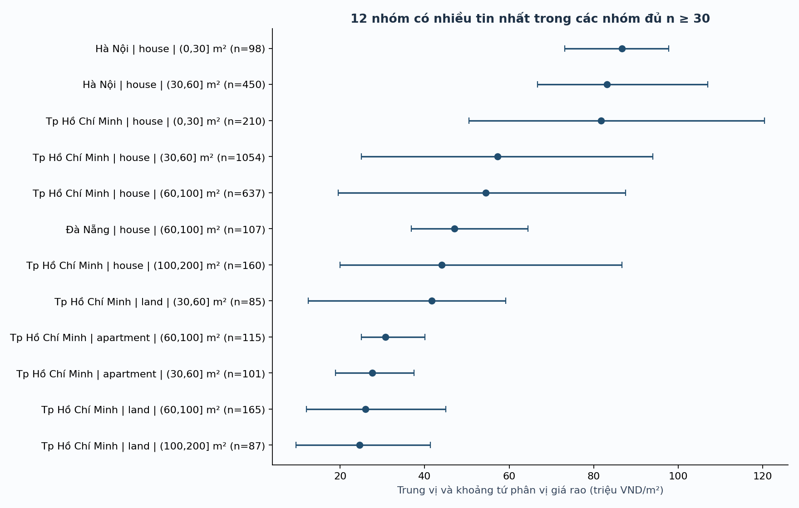
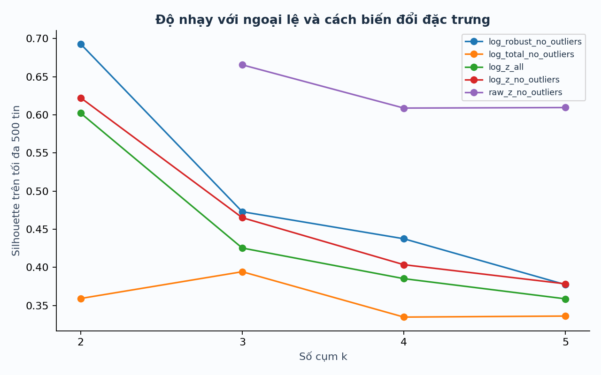

# Kết quả hoàn thiện ba mục tiêu

Lần chạy: `20261027T065401Z-5c8df2cc`. Ngày 27/10/2026. Giữ nguyên mã phân loại đã khóa trước khi đối chiếu evaluation; không sửa quy tắc theo các nhãn này.

## 1. Đối chiếu nhãn

Mẫu đã tách 120 tin phát triển và 60 tin đánh giá. Một thành viên gán nhãn ban đầu, sau đó AI sửa trực tiếp 17 tin theo yêu cầu. Chưa ghi nhận thành viên xác nhận lại các sửa đổi. Đây là đối chiếu với nhãn có hỗ trợ AI, không phải gold labels người độc lập và không tính đồng thuận giữa hai người.

| Trường | Khớp / có nhãn xác định | Chưa xác định / 60 |
|---|---:|---:|
| Loại tài sản | 43/58 | 2 |
| Giao dịch | 28/45 | 15 |
| Cơ sở giá | 46/54 | 6 |
| Tổng giá | 47/50 | 10 |
| Diện tích | 53/54 | 6 |
| Giữ/cách ly | 8/8 | 52 |

Không diễn giải 8/8 quyết định giữ/cách ly thành accuracy 100%: còn 52/60 tin review. Các trường unknown, số trống và review không được tính thành sai/đúng. sale_assumed và other_unknown được xem là chưa khẳng định, không được tính khớp với nhãn cụ thể. Các phép so số dùng cả giá trị parser của tin cách ly, không chứng minh quyết định giữ đúng.

`evaluation_metrics.csv` báo riêng ba tầng lấy mẫu; tỷ lệ gộp là mô tả mẫu, không suy rộng toàn bộ 9.004 tin. Mẫu không tự trọng số. Mô tả đầy đủ trong bộ nhãn có nhiều thông tin hơn bộ phân loại tiêu đề, nên chênh lệch không chỉ là lỗi thuật toán.

## 2. Phân tích theo nhóm

Lượt chạy giữ 6.911 tin, cách ly 209 tin và gộp 1.884 dòng trùng, tổng 9.004 dòng. Trung vị tổng giá 2,25 tỷ VND, diện tích 70m² và đơn giá 32,50 triệu VND/m².

Tạo 405 nhóm tỉnh × loại × khoảng diện tích. Có 41 nhóm biết tỉnh/loại với n≥30, tổng 4.594 tin. Mỗi nhóm có n, trung vị, Q1–Q3, tỷ lệ ngoại lệ và thay đổi trung vị khi bỏ IQR nhóm. Nhóm nhỏ vẫn lưu trong CSV nhưng không dùng làm so sánh chính. Mức n≥30 là quy ước trình bày, không bảo đảm đại diện. Ý nghĩa diện tích đất/sàn/sử dụng vẫn chưa đồng nhất.



## 3. Độ ổn định phân cụm

Thử 5 cấu hình × k=2–5 × 3 seed (7,42,2026), cộng 5 mẫu con 80%: 65 lần fit. Mỗi lần dùng 10 khởi tạo K-means. Kết quả chính vẫn k=2 trên 6.652 tin không có cờ IQR nhóm; silhouette mẫu 1.000 tin là 0,5934.

So cùng k=2 trên các ID chung, lấy log diện tích–log đơn giá, z-score, bỏ ngoại lệ và seed 42 làm mốc:

| Thay đổi | ARI |
|---|---:|
| Không đổi | 1.0000 |
| Giữ ngoại lệ | 0.9764 |
| Thang gốc và z-score | 0.0071 |
| Log và trung vị/IQR | 0.7221 |
| Log diện tích và log tổng giá | 0.1833 |

Năm mẫu con 80% đạt ARI 0,9792–0,9980. Cụm ổn định với lấy mẫu và khởi tạo đã thử nhưng nhạy với cách biểu diễn đặc trưng. Không gọi cụm là phân khúc thị trường được xác minh. Silhouette của phần mở rộng dùng tối đa 500 tin; mẫu chỉ có một cụm thì để trống và ghi lý do. Không thay điểm thiếu bằng 0 hoặc dùng điểm cao ở một hình học để khẳng định tốt hơn mọi hình học khác.



## Chạy lại

Từ thư mục repo, sau khi cài requirements.txt:

```bash
python scripts/run_project.py --skip-download
python scripts/complete_analysis.py --labels docs/manual_validation/private/DANH_GIA_60_DA_SUA_CO_HO_TRO_AI.xlsx
python tools/build_dashboard.py
```

Workbook cần Node và Artifact Tool: `node tools/build_workbook.mjs`, sau đó dựng lại dashboard và chạy `python tools/verify_delivery.py --require-workbook`. Khi chạy lại pipeline sẽ đổi run_id; báo cáo Word cần cập nhật lại, không tự dùng bản cũ.

## Phần còn giới hạn

- Chưa có nhãn người độc lập cho toàn bộ bộ nhãn cuối; 52 tin review là kết quả chưa quyết định, không tự lấp.
- Dữ liệu lịch sử là mẫu thuận tiện, còn khả năng tin gần trùng và lỗi nguồn; không đại diện thị trường hiện tại.
- Chưa nghiệm thu thao tác Microsoft Excel thật hoặc toàn bộ bố cục trình duyệt; kiểm logic và engine không thay thế những việc đó.
- Các thay đổi mới ở máy cục bộ, chưa commit/push hay nộp thay nhóm.
