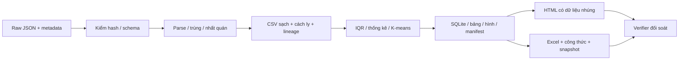
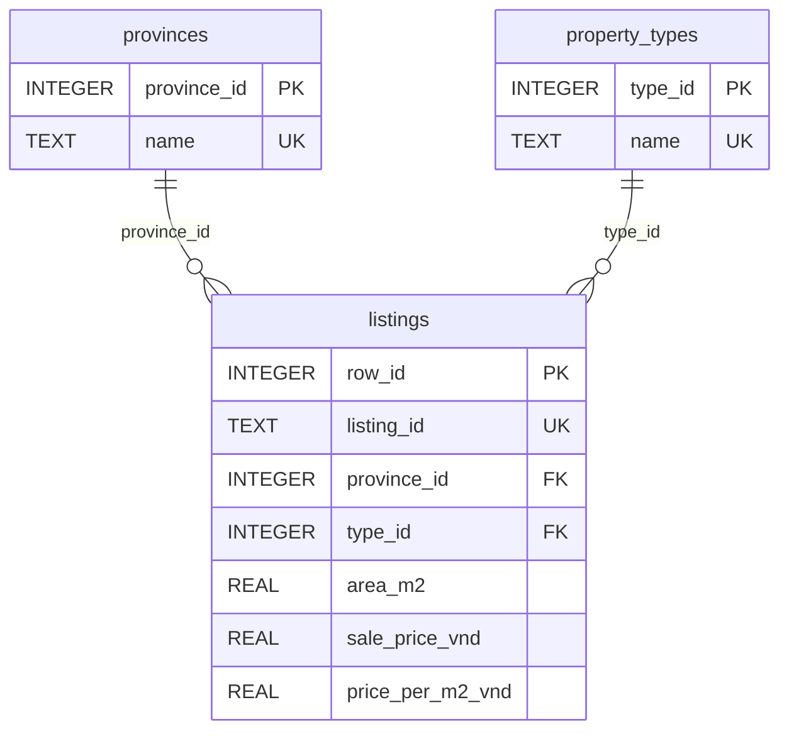

# Hồ sơ nguồn, quy tắc và thiết kế để tiếp quản

Người chuẩn bị: trợ lý Codex, ngày 16/10/2026. Đây là tài liệu kỹ thuật hỗ trợ sáu chương báo cáo, chưa phải bản báo cáo hoàn chỉnh. Mốc dữ liệu `20261016T015620Z-f2e661a6`.

## 1. Nguồn và mục tiêu duy nhất

Mục tiêu là xây dựng quy trình có thể chạy lại để khám phá, so sánh giá rao trong mẫu tin bất động sản lịch sử sau kiểm tra chất lượng. Người vận hành chạy Python; người xem mở HTML/Excel hoặc truy vấn SQLite. Đây là hai cách sử dụng, không phải hai vai trò được xác thực/phân quyền trong phần mềm.

Nguồn: *Vietnam Real Estate Data*, Duc Chung Tran, Huy Hoang Nguyen, Hong Son Ha, Mendeley Data v2, công bố 12/01/2021, DOI [10.17632/5477zhnmn2.2](https://doi.org/10.17632/5477zhnmn2.2), CC BY 4.0. Metadata, manifest và quyền sử dụng đã lưu tại `data/raw` và [hồ sơ nguồn](../references/DATA_SOURCE.md). File 24.292.489 byte, SHA-256 `ef39f153f48a55af07baa86883cd9036652f6d52232fed0be6e8991c7a5bf811`.

Mô tả nguồn ghi 10.000 tin nhưng file thực có 9.004. Đơn vị quan sát là bản ghi tin quảng cáo, không phải giao dịch hoặc căn nhà độc nhất. Không có ngày mỗi tin, tọa độ, mã tin ổn định, nhãn chuẩn hay phương pháp lấy mẫu đủ để suy rộng. Địa phương giữ nhãn lịch sử, không tự chuyển địa giới năm 2026. Không dự báo giá hiện tại, không khuyến nghị đầu tư.

Chỉ dùng năm trường lõi `title`, `price`, `area`, `location`, `description`. Các trường chi tiết có dấu hiệu lặp kéo dài giữa loại tin khác nhau; chưa xác minh cơ chế thu thập, nên không dùng số phòng/pháp lý/nội thất để kết luận. Tiêu đề và mô tả chỉ là nguồn thông tin để kiểm nhất quán, không phải sự thật đã xác nhận.

## 2. Từ điển dữ liệu thật

| Cột sạch | Kiểu/đơn vị | Nguồn và ý nghĩa kỹ thuật |
| --- | --- | --- |
| row_id | integer, từ 1 | Vị trí bản ghi trong mảng raw; truy nguyên, không phải mã tin trên website |
| listing_id | string | Băm khóa năm trường chuẩn hóa; nhận diện nội dung theo quy tắc, không nhận diện căn nhà |
| province | string | Nhãn tỉnh trong địa chỉ nguồn; 47 tỉnh xác định và một nhóm chưa rõ |
| district | string | Thành phần địa chỉ phù hợp mẫu; không suy từ tên đường |
| property_type | enum string | land / house / apartment / other_unknown, suy luận từ tiêu đề |
| transaction_status | enum string | sale / sale_assumed / sale_with_rental_income; không có xác minh giao dịch |
| area_m2 | number, m² | Diện tích đọc được; có thể khôi phục từ phần diện tích ghi rõ trong chuỗi giá |
| sale_price_vnd | number, VND | Giá rao được chuẩn hóa theo cơ sở giá; không phải giá giao dịch |
| price_per_m2_vnd | number, VND/m² | Giá rao từng dòng chia diện tích từng dòng |
| price_basis | string | Cơ sở quy đổi giá; không coi giá đơn vị là tổng tiền |
| area_source | string | Nơi lấy diện tích: trường diện tích hoặc phần diện tích trong chuỗi giá |
| source_review_evidence | string JSON | Cụm số/chữ dùng bởi quy tắc kiểm tra; không phải biên bản xác minh người thật |
| quality_flags | string, phân cách ; | Các cờ chất lượng, có thể nhiều cờ một tin |
| is_outlier_global | boolean | IQR trên toàn mẫu; để phân tích độ nhạy |
| is_outlier_group | boolean | IQR theo tỉnh–loại, có dự phòng nhóm loại/toàn cục |
| iqr_group | string | Nhóm tham chiếu để tính ngưỡng, xem `iqr_bounds.csv` |
| cluster | integer | Cụm thăm dò 1/2; −1 nếu ngoài tập fit, không được gán cụm |
| area_band | string | Nhóm diện tích để tổng hợp |

Chi tiết giá trị enum và quy tắc lấy theo `src/pipeline.py` của mốc đã kiểm; không tự bổ sung cột/nghiệp vụ chưa code. CSV công khai đã bỏ tiêu đề, mô tả, địa chỉ chi tiết và thông tin liên hệ; raw giữ cục bộ, không commit.

## 3. Quy tắc xử lý và ví dụ

| Bước/hàm | Cách làm | Ví dụ/giới hạn |
| --- | --- | --- |
| `read_verified_source` | Kiểm SHA-256 và 9.004 dòng trước xử lý | Sai nguồn thì dừng, không dùng đầu ra cũ làm kết quả mới |
| `normalize` | Unicode NFKC, thu gọn khoảng trắng, casefold | Phục vụ so khớp; không sửa raw |
| `parse_number` | Dấu phẩy thập phân; dấu chấm chia nhóm ba chữ số được gắn cờ | `11.300` theo quy ước 11.300 m², vẫn có bất định và sensitivity |
| `parse_area`, `parse_price` | Chuẩn m²/VND, đọc tỷ/triệu, xác định cơ sở giá | Dòng 1: 2,38 tỷ, 100 m² → 23,8 triệu/m² |
| `classify_title` | Từ khóa loại/giao dịch; giữ nhóm chưa rõ | Mô tả có thể rõ hơn tiêu đề; không tuyên bố độ chính xác nhãn |
| `clean_records` | Gộp nội dung trùng theo năm trường chuẩn hóa | 1.884 dòng trùng; không gọi đây là 1.884 căn nhà trùng |
| `check_source_consistency` | Kiểm số/đơn vị, xung đột, thuê/bán, sang kinh doanh, thanh toán chưa rõ | Dòng 638: 20 triệu/m²; không dùng 20 triệu như tổng giá. Dòng 335: 2 m² so với 2 ha |
| Chính sách cách ly | Giữ lý do và lineage, không tự sửa giá/diện tích nghi sai | 184 tin cách ly; số lượt lý do có thể chồng nhau |
| `add_outlier_flags` | Q1/Q3 và ngưỡng 1,5 IQR; tỉnh–loại nếu n≥30, nếu thiếu dùng loại hoặc toàn mẫu | 260 cờ nhóm; giữ trong EDA mặc định, bỏ khỏi fit K-means |
| `summarize_groups`, `sensitivity_table` | Tổng hợp trung vị, phân vị, bootstrap theo phần có triển khai; so điều kiện lọc | Trung vị của đơn giá từng tin khác tổng giá chia tổng diện tích |
| `cluster_records` | Log, Z-score, K-means++/Lloyd, thử k=2–5 và seed | Cụm thăm dò, không phải mô hình định giá |
| `build_database` | Tạo ba bảng, ghi dữ liệu có ràng buộc, benchmark cùng truy vấn | Kiểm toàn vẹn/FK và kết quả trước/sau index |
| Manifest/staging | Sinh đầu ra trong vùng tạm, xuất bản bộ kết quả, manifest cuối | Hash phát hiện file cũ/sửa riêng; không thay thế kiểm đúng dữ liệu nguồn |

Tổng đối soát: 9.004 = 1.884 trùng + 184 cách ly + 6.936 giữ. Khôi phục diện tích thành công cho 349 tin giữ. Có 3.891 tin giả định bán và 1.120 tin chưa xác định loại; không điền giá trị suy đoán để làm đẹp tỷ lệ đầy đủ.

## 4. Kiến trúc và dữ liệu minh họa

Hình đề xuất: Sơ đồ luồng xử lý dữ liệu. Dữ liệu minh họa: raw dòng 1 có 100 m² và 2.380.000.000 VND; sau parse đơn giá 23.800.000 VND/m²; tổng hợp và xuất sang CSV, listings trong SQLite, dashboard và Excel. Không dùng ảnh sơ đồ này như bằng chứng đã thao tác giao diện.

Hình đề xuất: Quan hệ ba bảng trong SQLite. Sơ đồ rút gọn, lược đồ đầy đủ ở `sql/01_schema.sql`. Có 48 hàng tỉnh gồm nhóm chưa rõ, bốn loại suy luận và 6.936 listings. Dòng minh họa: row_id=1, diện tích=100, giá=2.380.000.000, đơn giá=23.800.000. Khóa ngoại nối tới tên tỉnh/loại tương ứng; không vẽ 32 bảng hoặc phân quyền không có trong mã.

## 5. Mô-đun và hợp đồng tích hợp

| File | Đầu vào → đầu ra | Điều kiện lỗi/chú ý |
| --- | --- | --- |
| `scripts/download_data.py` | URL pin → raw đúng SHA | Không ghi đè bản đúng; sai tải/hash thì dừng |
| `src/pipeline.py` + `source_checks.py` | Raw → processed, bảng, hình, DB, analysis, manifest | Cách ly có lý do; staging trước công bố |
| `src/artifact_contract.py` | Mã/nguồn/đầu ra → kiểm phiên bản | Phát hiện file sửa riêng hoặc manifest cũ |
| `tools/build_dashboard.py` + template | Processed cùng manifest → HTML tự chứa | Cần dựng lại sau đổi dữ liệu; mở bằng trình duyệt |
| `tools/build_workbook.mjs` | Processed + analysis → xlsx + bằng chứng dựng/tính lại | Cần runtime Node/Artifact Tool; Python pip không đủ để dựng workbook |
| `scripts/demo_sql.py` | DB + bốn SQL → kết quả đọc | Không đoán AVG là median |
| `tools/verify_delivery.py` | Sản phẩm lưu → audit JSON hoặc lỗi | `--require-workbook` đối soát cả Excel; không kiểm hình thức trình duyệt |
| `scripts/run_project.py` | Một lệnh → tải/kiểm nguồn, pipeline, dashboard, test, verify | Workbook tùy chọn; không tự tái tạo báo cáo |
| `tools/prepare_handover_evidence.py` | Sản phẩm đã kiểm → đối soát bổ sung và hồ sơ bàn giao | Không sửa raw, quy tắc hoặc đầu ra phân tích chính |

Các file ghép bằng dữ liệu có schema và run_id, không qua backend/API bất động sản trực tuyến. Dashboard lọc/tính bằng JavaScript trên dữ liệu nhúng. Excel có I=H/G với kiểm số dương; Q/R đổi đơn vị, S lấy diện tích hợp lệ. Cờ IQR, cụm, bảng snapshot cần dựng lại pipeline/workbook khi đổi nguồn, không tự huấn luyện lại trong Excel.

Chỉ thêm mô hình, nguồn hay chức năng khi phục vụ mục tiêu và có đánh giá. Đối chiếu slide cụ thể tại [ma trận môn học](../references/DOI_CHIEU_SLIDE.md); bootstrap/silhouette/ARI là phần mở rộng, phải giải thích riêng khi dùng.
