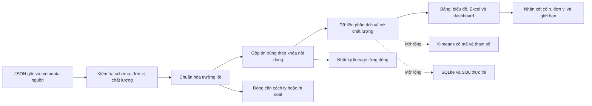

# Phân công, kế hoạch cải tiến và nội dung báo cáo đồ án

**Đề tài:** Xây dựng, xử lý và trực quan hóa bộ dữ liệu bất động sản Việt Nam để rút ra các ý nghĩa.

**Nhóm:** Võ Văn Đạt — N23DCCN078; Nguyễn Thị Yến Nhi — N23DCCN112; Hứa Như Quỳnh — N23DCCN118.

**Phạm vi chính:** đề tài STT 22/47 trong danh sách đăng ký, gắn với Chương 1–3. K-means và SQLite là phần mở rộng có mã chạy và bằng chứng thực nghiệm; không biến đề tài thành bài toán bắt buộc dự đoán giá nhà.

## 1. Cách dùng bộ bàn giao và trách nhiệm học thuật

Bộ bàn giao cung cấp dữ liệu gốc, nguồn dẫn, mã xử lý, dữ liệu phân tích và kiểm tra chất lượng, biểu đồ, Excel, dashboard ngoại tuyến và bản báo cáo nền. Đây là **bản nền để học, kiểm chứng và phát triển**. Nhóm cần đọc mã, chạy lại, kiểm tra số liệu, thực hiện phần cải tiến được giao và tự bảo vệ lựa chọn phương pháp. Không ghi trong báo cáo rằng nhóm đã tự thu thập hoặc đã thực hiện những thí nghiệm chưa có kết quả.

Giữ ba trạng thái rõ ràng trong nhật ký công việc:

| Trạng thái | Ý nghĩa | Minh chứng cần có |
|---|---|---|
| Có trong bộ bàn giao | File và kết quả nền do trợ lý chuẩn bị | Đường dẫn file; lệnh chạy; phiên bản hoặc checksum |
| Đã kiểm chứng bởi thành viên | Người phụ trách tự chạy và đối chiếu được kết quả | Ngày kiểm tra; log; bảng đối chiếu; người kiểm tra chéo |
| Đã cải tiến bởi nhóm | Có thay đổi thực chất so với bản nền | Giả thuyết; thay đổi mã/quy tắc; kết quả trước/sau; quyết định giữ hoặc bỏ |

Các thí nghiệm trong mục phân công dưới đây là **việc cần làm**, không phải kết quả đã xảy ra. Thí nghiệm cho kết quả không cải thiện vẫn có giá trị nếu nhóm ghi nhận trung thực và giải thích được.

Tài liệu định hướng phải đọc trước: [đối chiếu slide](../references/DOI_CHIEU_SLIDE.md), [nguồn dữ liệu](../references/DATA_SOURCE.md) và README ở thư mục gốc. Số trang slide trong tài liệu đối chiếu là trang PDF tính từ 1.

### Các kết quả nền để tiếp quản

Ở bản nền hiện tại, pipeline đã tạo **7.001 tin được giữ, 1.884 tin trùng theo năm trường lõi chuẩn hóa và 119 tin cách ly**, cân bằng với 9.004 bản ghi gốc. Năm trường dùng cho khóa trùng là `title`, `price`, `area`, `location`, **`description`**; số chẩn đoán trùng theo bốn trường trong tài liệu nguồn không phải số dòng mà pipeline cuối đã gộp. Các nhóm nguyên nhân cách ly có thể chồng nhau.

Tập giữ gồm tin có tiêu đề bán rõ, tin được suy luận là bán từ ngữ cảnh bộ dữ liệu và tin bán có nhắc nguồn thu cho thuê. Vì vậy, “được giữ” không đồng nghĩa được xác minh là một giao dịch bán thực. Ngoại lệ IQR được giữ trong EDA chính; chúng được loại khỏi riêng tập fit K-means. Thống kê đầy đủ và chính sách nằm trong `outputs/analysis.json`.

| Thành phần nền | File để học và kiểm chứng |
|---|---|
| Kết quả/cờ từng dòng và truy nguyên | `data/processed/listings_clean.csv`, `listings_rejected.csv`, `row_lineage.csv` |
| EDA và độ nhạy | `outputs/analysis.json`; `outputs/charts/01_price_distribution.png` đến `08_spearman_correlation.png`; các bảng trong `outputs/tables/` |
| Sản phẩm tương tác | Excel trong `outputs/`; `outputs/DASHBOARD_BAT_DONG_SAN.html` |
| K-means | `src/pipeline.py`; bảng thử k và mô tả cụm trong output; đã thử k=2–5 và seed chính/7/42 |
| SQL | `outputs/real_estate.sqlite`; `sql/01_schema.sql`, `02_queries.sql`, `03_indexes.sql`; `outputs/sql_benchmark.json` |

Sau khi nhóm sửa phương pháp hoặc chạy lại, lấy số mới trực tiếp từ output và cập nhật đồng bộ tài liệu; không giữ số nền nếu kết quả đã thay đổi.

## 2. Phân công cân bằng cho ba thành viên

Tỷ trọng **1/3 mỗi người** là kế hoạch đóng góp nội bộ, không phải thang điểm của thầy. Mỗi người có một phần kỹ thuật, một phần kiểm chứng/cải tiến, một phần báo cáo và một nhiệm vụ kiểm tra chéo.

| Thành viên | Phần nền được bàn giao để tiếp quản | Nội dung báo cáo chính | Người kiểm tra chéo |
|---|---|---|---|
| **Võ Văn Đạt — N23DCCN078** | Mã `src/pipeline.py`; luồng chạy từ raw tới output; phần K-means; cơ sở dữ liệu và SQL trong `sql/`; tích hợp và hướng dẫn tái lập | Sơ đồ quy trình, khả năng tái lập; Chương 5 phần mở rộng; phụ lục mã/lệnh chạy; hợp nhất báo cáo | Nhi kiểm tra dòng dữ liệu vào/ra; Quỳnh kiểm tra số liệu hiển thị |
| **Nguyễn Thị Yến Nhi — N23DCCN112** | `data/raw/`; `references/DATA_SOURCE.md`; quy tắc làm sạch; `data/processed/listings_clean.csv`, `row_lineage.csv` và dữ liệu cách ly/kiểm toán | Chương 2 nguồn và từ điển; Chương 3 làm sạch; phần thiên lệch và chất lượng dữ liệu trong Chương 6 | Quỳnh đọc lại diễn giải; Đạt kiểm tra quy tắc được thực thi |
| **Hứa Như Quỳnh — N23DCCN118** | `outputs/analysis.json`; bảng/biểu đồ trong `outputs/`; Excel; `outputs/DASHBOARD_BAT_DONG_SAN.html`; `tools/build_dashboard.py` | Chương 1 câu hỏi nghiên cứu; Chương 4 EDA; Chương 6 kết luận; biên tập bố cục và tài liệu trình bày | Đạt đối chiếu dữ liệu dashboard; Nhi đối chiếu mẫu số/đơn vị |

Đạt phụ trách ghép bản cuối, nhưng từng người phải tự viết phần được giao. Quỳnh thống nhất văn phong và cách trình bày, nhưng không gánh toàn bộ công việc viết báo cáo. Nhi kiểm tra chất lượng dữ liệu, nhưng cả ba cùng chịu trách nhiệm về kết luận và nguồn dẫn.

### 2.1. Võ Văn Đạt: thực thi, K-means, SQL và tích hợp

**Cần hiểu:** luồng dữ liệu từ JSON tới CSV/Excel/dashboard; hàm và biến trong `src/pipeline.py`; điều kiện lọc và mối liên hệ giữa các output; K-means gán cụm/cập nhật tâm/điều kiện dừng; tác dụng của log và co giãn; `CREATE TABLE`, khóa, `SELECT`, `GROUP BY`, index và `EXPLAIN QUERY PLAN`.

**Slide học trọng tâm:** Chương 1 trang 12; Chương 2 trang 14–17 và 28–29; `Chương 4 - Hoc may - 2.pdf` trang 48–53; Chương 5 phần 1 trang 23–32 và 36–38. Không học thuộc toàn bộ Chương 4 nếu không sử dụng các thuật toán khác.

**Việc thực hiện và sản phẩm nộp nội bộ:**

1. Chạy lại toàn bộ project theo README trên máy nhóm; lập bảng đầu vào/đầu ra, môi trường và lệnh chạy trong `docs/BIEN_BAN_TAI_LAP.md`. Giải thích ít nhất ba hàm quan trọng và kiểm tra một bản ghi từ raw tới cleaned tới biểu đồ.
2. Kiểm chứng K-means nền đã xét k=2–5, seed chính và seed 7/42. Thực nghiệm cải tiến: thử thêm ít nhất ba seed khác, hoặc đối chiếu Z-score biến gốc với log rồi Z-score trên **cùng tập fit**, giữ các điều kiện khác. Lưu bảng kích thước cụm, inertia, silhouette, độ đồng thuận phân hoạch khi phù hợp và thời gian chạy. Không so trực tiếp inertia giữa hai không gian biến khác nhau như cùng thang đo. Giải thích lựa chọn k dựa trên khả năng diễn giải và độ ổn định; không tự tạo nhãn “đúng” để tính Accuracy. Lưu `outputs/experiments/kim_dinh_kmeans.csv` và `docs/THUC_NGHIEM_KMEANS.md` sau khi chạy thật.
3. Thực nghiệm SQL: dùng DB thật được tạo từ dữ liệu sạch; đọc SQL đang có; đo cùng truy vấn trước/sau index với cùng tham số và nhiều lượt. Kiểm tra hai kết quả bằng nhau. Lưu truy vấn, kế hoạch thực thi, số dòng và trung vị thời gian vào `docs/THUC_NGHIEM_SQL.md`. Ghi nhận cả trường hợp index không nhanh hơn trên dữ liệu nhỏ.
4. Cải tiến thực chất ưu tiên: làm rõ lệnh chạy, đường dẫn tương đối theo thư mục gốc, xử lý lỗi đầu vào và quy trình tạo lại output; hoặc bổ sung một kiểm tra đối chiếu tổng số dòng CSV–DB–dashboard. Không thay đổi quy tắc làm sạch mà chưa thống nhất với Nhi.
5. Viết phần phương pháp tái lập và Chương 5; ghép báo cáo từ ba phần đã được phản biện; kiểm tra không còn biến/tên file/số liệu cũ.

**Nghiệm thu:** thành viên khác chạy lại được bằng hướng dẫn; DB mở được và SQL trả kết quả; các tuyên bố về tốc độ có số đo; seed/biến/k được ghi rõ; biết tự tính một vòng gán cụm/cập nhật tâm trên ví dụ nhỏ; không gọi K-means là mô hình dự đoán giá.

### 2.2. Nguyễn Thị Yến Nhi: nguồn, làm sạch và kiểm chứng

**Cần hiểu:** đơn vị quan sát; giá rao và giá giao dịch; CC BY 4.0; sự khác nhau giữa ô có nội dung và dữ liệu đúng; dấu phân cách số Việt Nam; trùng theo khóa nội dung và cùng bất động sản; thiếu, nhiễu, không nhất quán; outlier và lỗi; đơn vị gốc và co giãn số.

**Slide học trọng tâm:** Chương 2 trang 3, 5–17, 23–24 và 28–29; Chương 1 trang 3–5 và 12. IQR là kỹ thuật bổ sung cho khái niệm outlier của slide, cần giải thích công thức khi sử dụng.

**Việc thực hiện và sản phẩm nộp nội bộ:**

1. Đối chiếu DOI, tác giả, phiên bản, giấy phép và checksum; viết phần nguồn với con số **9.004 bản ghi thực tế**, công khai khác biệt so với mô tả nguồn “10,000 posts”. Không tự điền ngày đăng theo ngày công bố.
2. Hoàn thiện từ điển dữ liệu theo schema CSV thật: tên cột, kiểu, đơn vị, trường nguồn, công thức, trạng thái thiếu/cách ly, ý nghĩa cờ. Giải thích `area_m2` là diện tích **được nêu ở trường lõi trong tin**, không luôn đồng nhất diện tích đất hay sàn.
3. Kiểm tra thủ công một mẫu tối thiểu 60 bản ghi gồm nhiều tỉnh và các trường hợp thông thường, dấu chấm/phẩy, giá `đ` đáng nghi, tin trùng, loại hình suy luận, outlier. Chọn mẫu có chủ đích để kiểm tra lỗi, không mô tả là mẫu ngẫu nhiên đại diện thị trường. Ghi `row_id`, chuỗi raw, kết quả parse, nhận xét và quyết định vào `outputs/experiments/kiem_tra_thu_cong.csv`.
4. Thực nghiệm làm sạch: so sánh khóa trùng toàn đối tượng JSON, bốn trường lõi và **năm trường lõi đang dùng trong mã**; tính số mẫu và trung vị giá ở mỗi phương án. Giữ các quy tắc lọc khác giống nhau khi đối chiếu. Giải thích vì sao thay đổi khóa trùng có thể làm thay đổi trọng số của tin. Không kết luận đã đếm đúng số căn nhà duy nhất.
5. Thực nghiệm độ nhạy: kiểm chứng bảng độ nhạy tổng thể đã có; mở rộng sang n, trung vị và thứ hạng **từng tỉnh/loại hình đủ mẫu** khi có/không tạm ẩn điểm IQR. Kiểm tra thêm phương án chỉ dùng tiêu đề bán rõ thay vì các tin `sale_assumed`. Không xóa outlier khỏi raw và không loại tự động chỉ để biểu đồ đẹp hơn.
6. Cải tiến ưu tiên: bổ sung một quy tắc parse có ví dụ đối chứng, hoặc kiểm tra nhất quán diện tích/giá giữa các trường lõi; các trường hợp mơ hồ đưa vào danh sách rà soát. Lưu `docs/NHAT_KY_QUY_TAC_LAM_SACH.md` với lý do, số dòng tác động và quyết định cuối cùng.
7. Viết Chương 2–3 và phần giới hạn chất lượng; đối chiếu bảng trước/sau với nhật ký từng dòng. Nếu số lỗi chồng nhau, không cộng cơ học thành tổng dòng loại.

**Nghiệm thu:** mọi quy tắc có ví dụ raw và kết quả; truy được một dòng loại về bản gốc; kiểm đếm đầu vào bằng tổng các trạng thái cuối cùng không chồng nhau; không dùng trường chi tiết có dấu hiệu lan truyền để đưa kết luận chắc chắn về số phòng/pháp lý; mọi sửa quy tắc đều chạy lại output.

### 2.3. Hứa Như Quỳnh: EDA, dashboard và diễn giải

**Cần hiểu:** câu hỏi phân tích; biến số và biến phân loại; histogram/bar/scatter; phân phối lệch; trung bình/trung vị/IQR; trục log; mẫu số và bộ lọc; tương quan khác nhân quả; giá trên m² có mẫu số nào; mẫu ít và thiên lệch địa phương.

**Slide học trọng tâm:** Chương 1 trang 3–5 và 12; Chương 3 trang 3–7, 14–18, 22–30; Chương 2 trang 28–29. Không dùng biểu đồ đường làm xu hướng khi không có thời gian quan sát.

**Việc thực hiện và sản phẩm nộp nội bộ:**

1. Đọc `outputs/analysis.json`, đối chiếu ít nhất ba KPI/bảng với CSV/Excel bằng một cách độc lập. Ghi công thức và bộ lọc trong `docs/DOI_CHIEU_SO_LIEU_TRUC_QUAN.md`.
2. Thực nghiệm biểu đồ: so sánh histogram trục gốc và log; thử ít nhất hai cách chia bin phù hợp; chọn phương án đọc tốt hơn mà không che giấu điểm cực trị. Lưu hình trước/sau và giải thích lựa chọn.
3. Thực nghiệm diễn giải: so sánh trung vị giá tổng và trung vị giá/m² theo tỉnh trong cùng tập lọc; xem kết luận có đổi không, có bị khác biệt về loại hình/diện tích và số mẫu chi phối không. Chỉ nêu kết quả sau khi đã tính.
4. Kiểm thử dashboard/Excel bằng các tình huống: tất cả dữ liệu; một tỉnh; một nhóm diện tích; bộ lọc không có kết quả; bật/tắt điểm IQR nếu giao diện hỗ trợ. Đối chiếu n và KPI với CSV đã lọc, kiểm tra cách hiển thị đơn vị, số thập phân và nguồn. Lưu `docs/BIEN_BAN_KIEM_TRA_DASHBOARD.md`.
5. Cải tiến ưu tiên: thêm chú thích số mẫu/đơn vị/nguồn, làm rõ trạng thái lọc, cải thiện trạng thái rỗng và tiêu đề; hoặc thêm một biểu đồ trả lời câu hỏi còn thiếu. Không thêm bản đồ vị trí chính xác hoặc xu hướng năm khi dữ liệu không có tọa độ/ngày.
6. Viết Chương 1, 4 và kết luận; mỗi nhận xét đi cùng số liệu, n, đơn vị, hình/bảng và giới hạn. Chuẩn bị bản trình bày theo kịch bản riêng; rà lỗi chính tả và đánh số hình/bảng toàn báo cáo.

**Nghiệm thu:** mỗi hình trả lời một câu hỏi; trục, đơn vị, n, nguồn rõ; bộ lọc dashboard không đổi ý nghĩa KPI; số liệu Excel/dashboard/báo cáo nhất quán; nhận xét không suy rộng thành toàn thị trường hoặc khuyến nghị đầu tư.

## 3. Kiểm tra chéo và tiêu chuẩn hoàn thành

| Người thực hiện | Kiểm tra phần của | Việc phải tự làm | Điều kiện ký xác nhận |
|---|---|---|---|
| Đạt | Quỳnh | Lọc CSV theo cùng điều kiện dashboard và đối chiếu n/KPI; mở file HTML ngoại tuyến | Kết quả khớp trong sai số làm tròn đã nêu; không lỗi bộ lọc |
| Nhi | Đạt | Kiểm tra số dòng DB với CSV; chọn một truy vấn và so sánh kết quả trước/sau index; kiểm tra seed/biến K-means | Không đổi tập dữ liệu giữa hai lượt đo; kết quả truy vấn tương đương |
| Quỳnh | Nhi | Truy nguyên ít nhất 10 ví dụ làm sạch; đọc phần phương pháp như người chưa biết project | Hiểu vì sao giữ/cách ly/gộp từng dòng; tìm được minh chứng đúng file |

Mỗi người ghi vào biên bản: hạng mục, file/phiên bản, người kiểm tra, kết quả, vấn đề còn lại và cách xử lý. Không ký nghiệm thu dựa trên việc file chỉ mở được. Sau mỗi thay đổi ảnh hưởng số liệu, chạy lại pipeline và cập nhật Excel, dashboard, bảng báo cáo cùng một lượt.

## 4. Lịch tương đối khi đã biết ngày nộp

Ký hiệu **T là ngày nộp thực tế do thầy công bố**. Đây là kế hoạch đề xuất, không phải hạn nộp đã xác nhận; nếu còn ít thời gian, ưu tiên phần cốt lõi và gộp các mốc.

| Mốc | Đạt | Nhi | Quỳnh | Sản phẩm chung |
|---|---|---|---|---|
| T−7 | Chạy và vẽ sơ đồ mã | Xác minh nguồn, từ điển, mẫu kiểm tra | Đọc kết quả, khóa câu hỏi | Thống nhất phạm vi và quy tắc; phân công được xác nhận |
| T−5 | Thực nghiệm k/seed và SQL | Thực nghiệm trùng, parse, IQR | Thực nghiệm biểu đồ và KPI | Mỗi người có kết quả thực nghiệm và quyết định có bằng chứng |
| T−3 | Ghép báo cáo phương pháp/mở rộng | Hoàn thành Chương 2–3 | Hoàn thành EDA/kết luận | Bản báo cáo hoàn chỉnh lần 1; mọi hình có nguồn và n |
| T−2 | Đối chiếu CSV–DB–dashboard | Kiểm tra kết quả Đạt | Kiểm tra quy tắc Nhi | Biên bản kiểm tra chéo; sửa lỗi và chạy lại toàn bộ |
| T−1 | Đóng gói, thử chạy từ đầu | Rà nguồn/từ điển/số dòng | Rà bố cục, tập trình bày | Bản cuối thống nhất; demo ngoại tuyến; mỗi người nói đúng phần mình |
| T | Phụ trách thao tác demo kỹ thuật | Trả lời về dữ liệu/làm sạch | Điều phối trình bày/EDA | Nộp đúng định dạng và quy định giảng viên |

## 5. Dàn ý báo cáo hoàn chỉnh và bằng chứng cần điền

Đề xuất khoảng 25–35 trang nội dung chính nếu thầy không có giới hạn riêng; chất lượng chứng cứ quan trọng hơn số trang. Bảng dài, mã và log chuyển sang phụ lục. Không có số trang tối thiểu chính thức được xác nhận trong tài liệu đã cung cấp.

### Phần đầu báo cáo

- Bìa: trường/khoa/môn, tên đề tài, giảng viên nếu được xác nhận, ba tên và mã sinh viên, lớp/học kỳ, ngày nộp thực tế.
- Trang phân công: vai trò, sản phẩm, tỷ trọng dự kiến và đóng góp thực tế sau khi hoàn thành; không dùng kế hoạch để khẳng định thành tích đã làm.
- Tóm tắt khoảng 150–250 từ: câu hỏi, dữ liệu 9.004 bản ghi gốc, phương pháp chính, 2–3 kết quả định lượng lấy từ output cuối, giới hạn quan trọng. Viết sau cùng.
- Mục lục tự động; danh mục hình, bảng và chữ viết tắt/đơn vị. Thống nhất “tỷ VND”, “triệu VND/m²”, “m²”, “tin”.

### Chương 1. Bài toán, mục tiêu và phạm vi

1. Lý do chọn bất động sản: nhiều biến số và dữ liệu quảng cáo không đồng nhất, phù hợp xử lý/trực quan hóa. Không viện dẫn tình hình giá hiện tại nếu không có nguồn riêng.
2. Xác định đề tài STT 22/47; sản phẩm là bộ dữ liệu có kiểm toán và các nhận xét mô tả.
3. Câu hỏi nghiên cứu đề xuất: tập tin phân bố địa phương như thế nào? Giá/diện tích có phân phối gì? Giá rao liên hệ thế nào với diện tích? Giá/m² khác ra sao giữa các nhóm đủ số mẫu? Quyết định làm sạch ảnh hưởng kết luận thế nào?
4. Đối tượng, đơn vị quan sát và phạm vi: tin quảng cáo trong file công bố năm 2021; không biết ngày đăng từng tin; không đại diện thị trường Việt Nam năm 2026.
5. Đầu ra và tiêu chí tự kiểm tra: truy nguyên, chạy lại, số liệu thống nhất, kết luận có hình/bảng; ma trận ánh xạ Chương 1–3. Phân cụm/SQL được đặt riêng là mở rộng.

### Chương 2. Nguồn dữ liệu và hiểu dữ liệu

1. Tác giả, Mendeley, DOI, phiên bản, giấy phép, ngày tải và checksum; phân biệt mô tả nguồn 10.000 với file thực 9.004.
2. Cấu trúc JSON và ví dụ đã che thông tin liên hệ nếu đưa nguyên văn mô tả; 29 trường hợp nhất và các trường lõi được dùng.
3. Từ điển dữ liệu gốc/đã xử lý; đơn vị và công thức `price_per_m2_vnd = sale_price_vnd / area_m2` khi mẫu số dương. Tên kỹ thuật `sale_price_vnd` trong code vẫn được diễn giải trong báo cáo là **giá rao**, không phải bằng chứng giao dịch.
4. Phân tích độ tin cậy: trường chi tiết nghi ngờ lan truyền, giá đáng nghi, thiếu ngày/tọa độ/ID, thiên lệch địa phương và nguồn quảng cáo.
5. Quyết định chọn biến: vì sao bỏ số phòng/pháp lý khỏi kết luận chính; nếu suy luận loại hình từ tiêu đề, ghi quy tắc, mức không xác định và hạn chế.

### Chương 3. Quy trình xử lý và kiểm tra chất lượng

1. Sơ đồ raw → kiểm tra → chuẩn hóa → gộp trùng/cách ly → tạo biến → dữ liệu phân tích → biểu đồ/Excel/dashboard; nhánh K-means/SQLite nếu dùng.
2. Quy tắc Unicode/khoảng trắng, tách giá và đơn vị, dấu phân cách số, diện tích, tách địa phương; mỗi quy tắc có lý do, ví dụ trước/sau và số dòng tác động.
3. Giá trị thiếu, không hợp lệ và mơ hồ: không điền giá trung bình chỉ để giữ đủ dòng; không tự sửa giá `đ` thành triệu; quyết định cách ly có nhật ký.
4. Định nghĩa khóa tin trùng năm trường lõi chuẩn hóa; số lượng trùng theo từng cách; giải thích khóa nội dung không xác định chắc chắn bất động sản duy nhất. Trình bày suy luận trạng thái bán và ngưỡng rà soát giá dưới 10 triệu VND như chính sách của nhóm, không phải chuẩn thị trường chính thức.
5. Ngoại lệ: cách tính IQR, nhóm tính và ngưỡng cụ thể trong mã; giữ/gắn cờ và phân tích độ nhạy. Phân biệt quy tắc IQR bổ sung với khái niệm outlier trong slide.
6. Tạo biến giá/m², nhóm diện tích, địa phương, cờ chất lượng; giải thích chuẩn hóa đơn vị khác Min–Max/Z-score; trình bày scaler ở phần K-means khi sử dụng.
7. Bảng chất lượng trước/sau, phương trình cân bằng số dòng theo các trạng thái cuối cùng, kết quả kiểm tra thủ công, ví dụ truy nguyên theo `row_id`/lineage và các lỗi chưa giải quyết.

### Chương 4. Khám phá và trực quan hóa dữ liệu

Mỗi tiểu mục gồm **câu hỏi → tập lọc và n → biểu đồ/bảng → 2–3 số liệu → diễn giải → giới hạn**. Lấy số liệu từ output cuối, không gõ ước lượng theo hình.

1. Phân bố tin theo tỉnh/loại hình suy luận: số mẫu và tỷ lệ, nêu mất cân đối địa phương.
2. Phân phối giá rao và diện tích: histogram, trung bình/trung vị/IQR, lý do dùng trục log; không bỏ cực trị mà không chú thích.
3. Diện tích và giá: scatter, số mẫu, loại trục; hệ số tương quan nếu tính được và giải thích hạn chế. Không gọi tương quan là tác động nhân quả.
4. So sánh giá/m² theo tỉnh/nhóm: trung vị, số mẫu, ngưỡng đủ mẫu, mô tả nhóm gộp; so sánh cùng định nghĩa và bộ lọc.
5. Độ nhạy của kết luận với trùng/outlier/quy tắc parse: một bảng trước/sau và nhận xét kết luận nào ổn định hoặc thay đổi.
6. Excel và dashboard: mục tiêu người sử dụng, KPI/bộ lọc, ảnh minh họa, cách tránh hiểu sai, đối chiếu số liệu và kiểm thử ngoại tuyến.

### Chương 5. Phần mở rộng có thực nghiệm — tùy chọn

**5.1 K-means:** mục đích mô tả nhóm tin; biến vào và tập lọc; log/scaler và lý do; thuật toán gán/cập nhật tâm; k, seed, điều kiện dừng; cách lựa chọn k; kích thước/đặc điểm cụm ở đơn vị gốc; minh họa; kết quả thay seed; giới hạn. Nếu dùng silhouette thì dẫn nguồn và giải thích vì đây là chỉ số bổ sung. Không gắn cụm thành “phân khúc thị trường chính thức”.

**5.2 SQLite và SQL:** sơ đồ bảng và khóa; tạo DB, nhập dữ liệu và số dòng; truy vấn tổng hợp; truy vấn đo trước/sau index; `EXPLAIN QUERY PLAN`; kết quả truy vấn bằng nhau; thiết bị/môi trường, số lượt và trung vị thời gian; đánh đổi dung lượng/chi phí ghi; giới hạn vì dữ liệu chỉ vài nghìn dòng. Không gọi minh họa này là giải pháp đã được kiểm chứng ở quy mô dữ liệu lớn.

Nếu không sử dụng phần mở rộng, bỏ các tuyên bố và phụ lục tương ứng; phần chính Chương 1–4 và kết luận vẫn phải hoàn chỉnh. Nếu giữ, phải có mã/DB/kết quả thực thi đúng yêu cầu thầy.

### Chương 6. Kết luận, giới hạn và hướng cải tiến

1. Trả lời từng câu hỏi Chương 1 bằng kết quả có số và dẫn hình/bảng; phân biệt phát hiện dữ liệu với nhận định ngoài dữ liệu.
2. Đóng góp: dữ liệu có nguồn, quy trình xử lý có thể kiểm toán, sản phẩm trực quan chạy được, các thí nghiệm nhóm thực sự hoàn thành.
3. Giới hạn: giá rao, thời điểm không rõ, mẫu không đại diện, tin trùng chưa chắc cùng nhà, diện tích không đồng nhất ngữ nghĩa, loại hình suy luận, trường chi tiết đáng nghi, thiếu biến và tương quan không nhân quả.
4. Hướng cải tiến có thể thực hiện: nguồn cập nhật có quyền sử dụng và ngày/ID rõ; phân biệt giao dịch–rao bán–cho thuê; kiểm tra nhãn thủ công lớn hơn; tách đất/nhà/căn hộ; đánh giá ngoài mẫu nếu sau này làm dự đoán. Không trình bày kế hoạch như kết quả đã có.

### Tài liệu tham khảo và phụ lục

- Tham khảo: các PDF môn học thực sự dùng; DOI dữ liệu; giấy phép; tài liệu chuyên môn cho IQR, silhouette, SQLite nếu dùng. Mỗi nguồn được nhắc trong nội dung và ghi nhất quán.
- Phụ lục A: từ điển đầy đủ, quy tắc parse và mẫu kiểm tra thủ công.
- Phụ lục B: schema, SQL và kế hoạch truy vấn, kết quả benchmark thực.
- Phụ lục C: thông số/seed/log K-means và ví dụ tính tay nhỏ.
- Phụ lục D: hướng dẫn chạy, môi trường, danh mục đầu ra và checksum nguồn.
- Phụ lục E: phân công thực tế, nhật ký thay đổi, biên bản kiểm tra chéo và đóng góp AI theo quy định môn/trường nếu có.

## 6. Sơ đồ quy trình nên đưa vào báo cáo

Sơ đồ là bố cục khái niệm; thứ tự gộp trùng/cách ly thực tế phải khớp mã cuối và được mô tả chính xác trong Chương 3.

## 7. Danh mục hình và bảng đề xuất

| Mã gợi ý | Nội dung | Bằng chứng nguồn |
|---|---|---|
| Hình 1 | Quy trình dữ liệu | Mã pipeline và sơ đồ trên |
| Bảng 1 | Đối chiếu nội dung với Chương 1–3 và phần mở rộng | `references/DOI_CHIEU_SLIDE.md` |
| Bảng 2 | Nguồn, phiên bản, đơn vị quan sát, checksum | Metadata và `references/DATA_SOURCE.md` |
| Bảng 3 | Từ điển biến chính | Schema CSV và công thức trong mã |
| Bảng 4 | Quy tắc làm sạch kèm ví dụ raw → processed | `row_lineage.csv` và nhật ký kiểm tra |
| Bảng 5 | Chất lượng trước/sau và cân bằng số dòng | Output kiểm toán và CSV |
| Hình 2 | Phân bố số tin theo tỉnh | Bảng tổng hợp với n |
| Hình 3–4 | Phân phối giá rao và diện tích | Tập phân tích, bin và đơn vị |
| Hình 5 | Scatter diện tích–giá | Tập lọc, n và loại trục |
| Hình 6 | Trung vị giá/m² theo nhóm đủ mẫu | Giá trị trung vị và n từng nhóm |
| Bảng 6 | Độ nhạy với quyết định làm sạch | Kết quả thí nghiệm nhóm thực chạy |
| Hình 7 | Excel và dashboard | Ảnh từ sản phẩm thật cùng phiên bản dữ liệu |
| Bảng/Hình 8 | Đặc điểm cụm và lựa chọn k nếu dùng | Output K-means thực |
| Bảng 7 | SQL trước/sau index nếu dùng | Truy vấn, execution plan, số lượt, thời gian |

Đây là danh mục để biên soạn; đánh số lại theo thứ tự xuất hiện và chỉ đưa hình/bảng đã có dữ liệu thật. Không cần mỗi ảnh một trang và không thay số liệu bằng ảnh chụp màn hình khó đọc.

## 8. Checklist trước khi hoàn thiện báo cáo

- [ ] Tên đề tài và câu hỏi khớp STT 22/47; phần mở rộng được đánh dấu.
- [ ] Đúng ba tên/MSSV; không còn chỗ trống giảng viên/lớp/ngày mà nhóm chưa xác nhận.
- [ ] Nguồn DOI, v2, CC BY 4.0; 9.004 dòng raw và khác biệt với mô tả nguồn được nêu.
- [ ] Số dòng sạch/cách ly/trùng lấy từ kết quả cuối; mẫu số không chồng nhau; file lineage truy nguyên được.
- [ ] Giá rao được gọi đúng; đơn vị VND/m² nhất quán; diện tích và loại hình có giới hạn ngữ nghĩa.
- [ ] Có bảng quy tắc trước/sau; không sửa raw; không tự điền dữ liệu làm kết luận đẹp hơn.
- [ ] IQR chỉ gắn cờ theo chính sách đã nêu; phân tích độ nhạy có kết quả thật.
- [ ] Từng nhận xét có n, số liệu, đơn vị, nguồn hình/bảng; không có khẳng định nhân quả hoặc thị trường hiện tại không có bằng chứng.
- [ ] CSV, Excel, dashboard, DB và báo cáo dùng cùng lần chạy.
- [ ] Nếu có K-means: có code, biến/scaler/k/seed, kết quả và giải thích; không dùng Accuracy sai mục đích.
- [ ] Nếu có tối ưu SQL: DB thật, SQL thật, kết quả tương đương, nhiều lượt đo và kế hoạch thực thi.
- [ ] Mỗi thành viên có thí nghiệm, phần viết, kiểm tra chéo và biết chạy phần mình.
- [ ] Tóm tắt/kết luận phản ánh đúng kết quả; hình/bảng đánh số và dẫn trong nội dung.
- [ ] Tài liệu tham khảo đủ nguồn đã dùng; mã/lệnh/môi trường và dữ liệu gốc đi kèm.
- [ ] Demo thử ngoại tuyến; bản PDF/Word cuối đọc rõ, không cắt hình/bảng; quy định nộp được nhóm tự đối chiếu với thông báo thầy.
